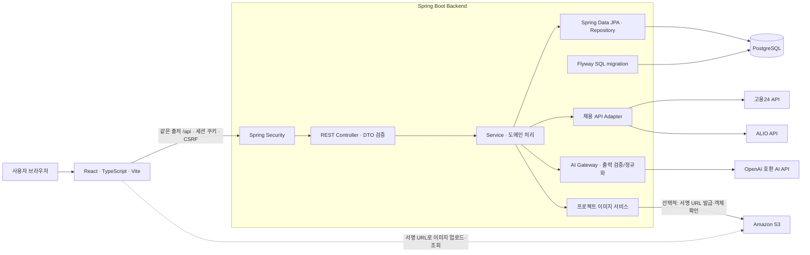
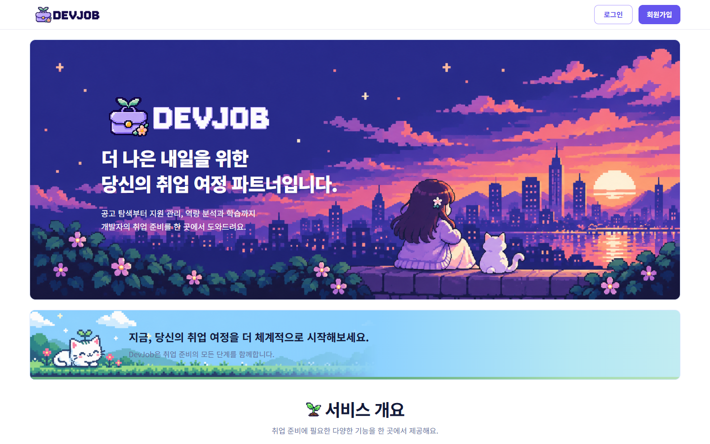
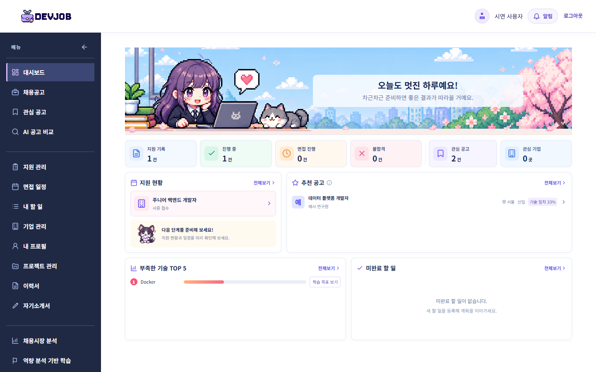
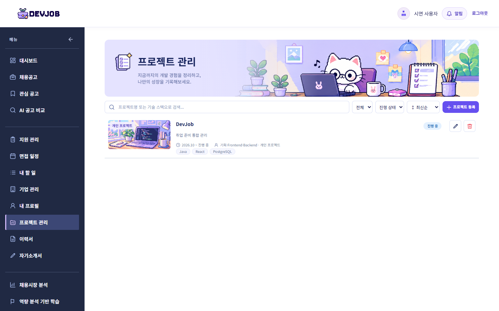
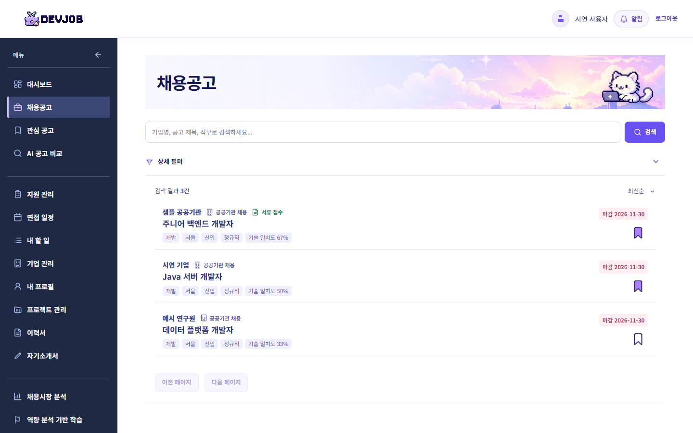
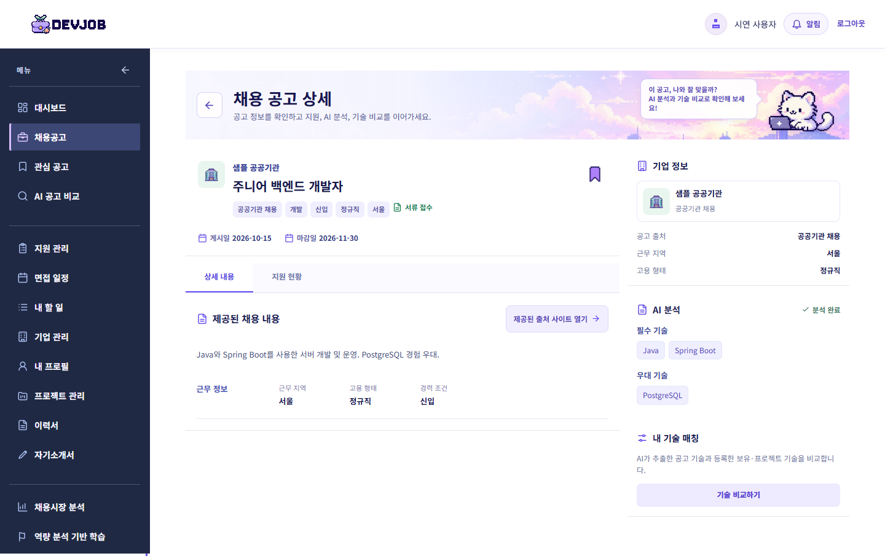
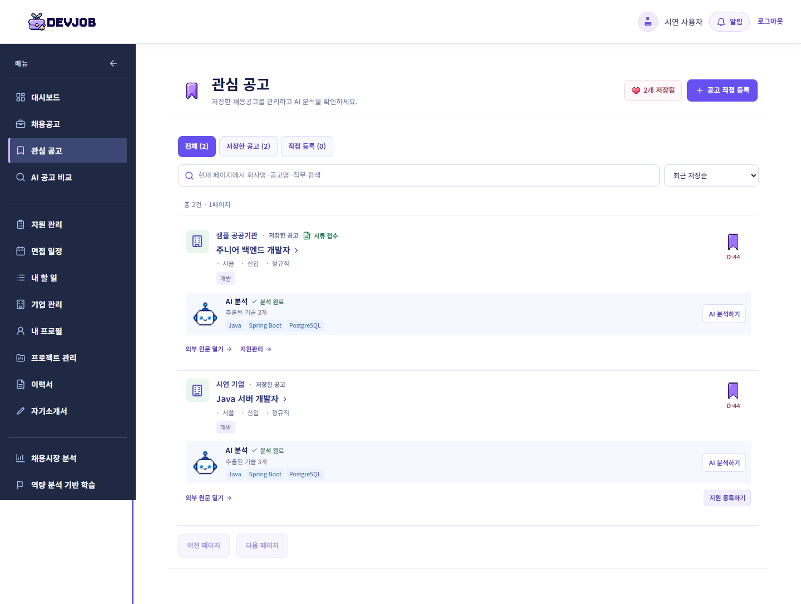
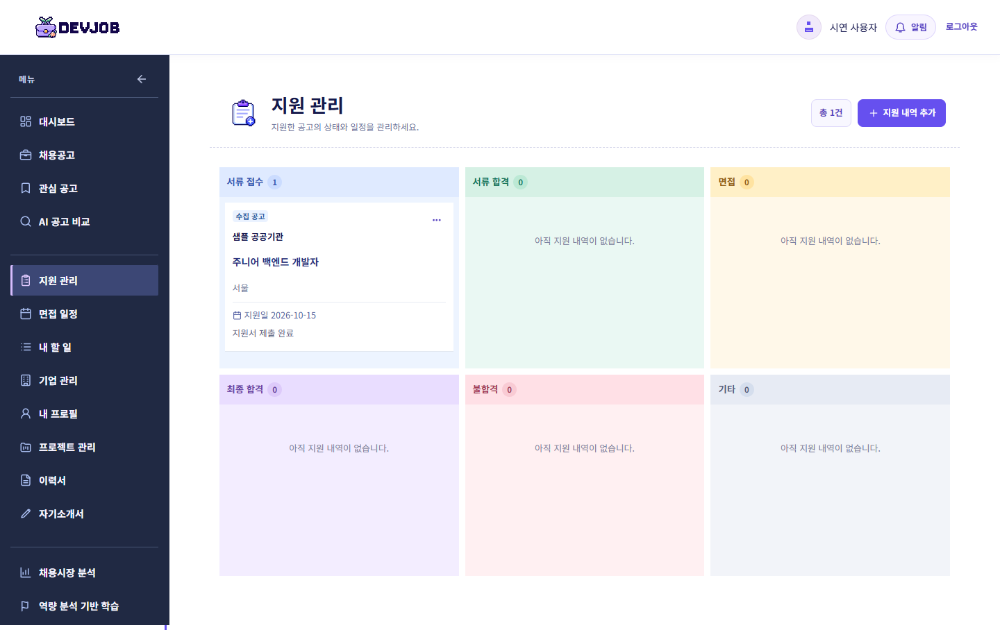
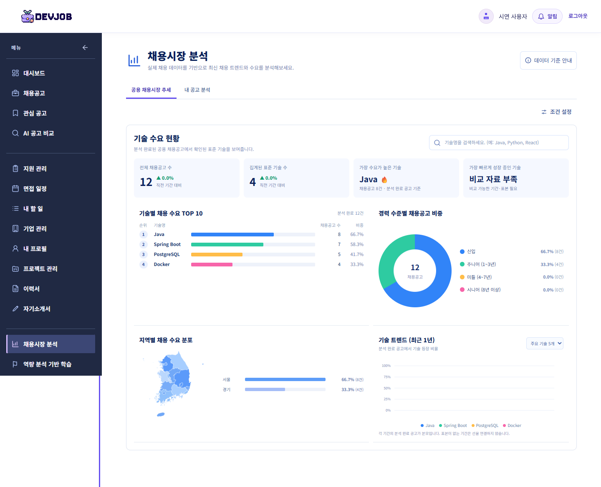

# DevJob

DevJob은 취업 준비 과정에 흩어진 채용공고, 관심 공고, 지원 이력, 보유 기술과 프로젝트 경험을 한곳에서 관리하는 취업지원 CRM입니다. 저장된 공고의 요구 기술을 분석하고 내 경험과 비교해 다음 준비 항목을 찾을 수 있습니다.

| 항목 | 내용 |
| --- | --- |
| 프로젝트 | 개인 프로젝트 |
| 개발 기간 | 2026.10~진행 중 |
| 담당 범위 | 기획, Frontend, Backend, 검증 |

| 영역 | 기술 |
| --- | --- |
| Frontend | React 19, TypeScript, Vite 8, CSS·Tailwind CSS |
| Backend | Java 17, Spring Boot 3.5, Spring MVC·Security·Data JPA, Spring AI |
| 데이터 | PostgreSQL 17, Flyway SQL migration, JPA `validate` |
| 개발·검증 | Gradle Wrapper, pnpm, Docker Compose, JUnit, Node.js 테스트 |
| 선택적 연동 | 고용24·ALIO 채용 API, OpenAI 호환 AI API, 프로젝트 이미지용 Amazon S3 |

## 로컬 실행

### 1. 준비

JDK 17, Node.js 22.18 이상, pnpm, Docker Compose가 필요합니다. 저장소 루트에서 `.env.example`을 `.env`로 복사하고 `DB_PASSWORD`에 로컬 개발용 비밀번호를 설정합니다. `.env`와 API 키는 Git에 올리지 않습니다.

```powershell
Copy-Item .env.example .env
# .env의 DB_PASSWORD를 설정한 뒤 실행
docker compose up -d --wait postgres
```

Compose는 PostgreSQL만 실행합니다. 기본 DB는 `devjob`, 호스트 포트는 `127.0.0.1:5432`이며 `.env`에서 바꿀 수 있습니다.

### 2. Backend

새 PowerShell에서 저장소 루트의 `.env` 값을 **현재 프로세스 환경변수**로 읽고 Backend를 실행합니다. Spring Boot는 Compose의 `.env`를 자동으로 읽지 않습니다.

```powershell
Get-Content .env | ForEach-Object {
    if ($_ -match '^([A-Z][A-Z0-9_]*)=(.*)$') {
        [Environment]::SetEnvironmentVariable($Matches[1], $Matches[2], 'Process')
    }
}
Set-Location backend
.\gradlew.bat bootRun
```

기본 API 주소는 `http://127.0.0.1:8080/api`입니다. 첫 기동 시 Flyway가 스키마를 적용하고 JPA가 매핑을 검증합니다. 로컬 HTTP에서는 예제의 `SESSION_COOKIE_SECURE=false`를 사용하며, HTTPS 환경에서는 `true`로 설정해야 합니다. `OPENAI_API_KEY`를 사용하지 않을 때는 **빈 값으로 지정하지 말고 설정하지 않습니다.** 외부 연동에 필요한 나머지 변수와 제한은 [Backend 안내](backend/README.md)를 참고하세요.

### 3. Frontend

다른 터미널에서 실행합니다.

```powershell
Set-Location frontend
pnpm install --frozen-lockfile
pnpm dev
```

기본 화면은 `http://127.0.0.1:5173`입니다. 개발 서버가 같은 출처의 `/api` 요청을 Backend로 프록시합니다. API 주소를 바꿨다면 `frontend/.env.example`의 `VITE_API_PROXY_TARGET`을 참고하세요. `VITE_*` 값은 브라우저에 노출되므로 키를 넣지 않습니다.

### 빌드와 테스트

```powershell
# 저장소 루트에서 실행
Push-Location backend
.\gradlew.bat build
Pop-Location

Push-Location frontend
pnpm build
pnpm test
Pop-Location
```

`dbTest`는 실제 PostgreSQL에 접속하고 일부 테스트는 데이터를 변경합니다. 개발 DB에서 일괄 실행하지 말고 단계별 **새 격리 DB**와 해당 `DB_NAME`을 준비한 뒤 [Backend 검증 안내](backend/README.md) 및 [S17 통합 검증](docs/s17-validation.md)의 가드를 확인하세요.

## 주요 기능

1. 계정·프로필과 보유 기술·프로젝트 경험을 관리합니다.
2. 저장된 채용공고를 검색하고, 관심 공고와 직접 등록한 공고를 관리합니다.
3. 지원 상태·이력, 면접 일정, 개인 할 일을 기록합니다.
4. 요청 시 공고의 요구 기술을 AI로 구조화하고, 사용자 기술과 비교합니다.
5. 저장된 분석 결과로 채용시장 기술 수요와 개인 Skill Gap을 확인하고 학습 목표를 관리합니다.
6. 대시보드에서 지원 현황과 다음 행동을 확인합니다. 이력서·자기소개서, 알림, 캐릭터 기능도 제공합니다.

기능별 REST 계약은 [API 명세](docs/api-spec.md)와 [확장 API 명세](docs/extension-api-spec.md), 데이터 구조는 [ERD](docs/erd.md)를 따릅니다.

## 시스템 아키텍처



- **인증·소유권:** Spring Security 서버 세션과 HttpOnly 쿠키를 사용하고 변경 요청에 CSRF 토큰을 요구합니다. 사용자 데이터는 세션 사용자 기준으로 조회·수정합니다.
- **저장 데이터와 외부 호출 분리:** 일반 CRM 조회는 PostgreSQL의 저장 데이터를 사용합니다. 채용 API 수집과 AI 분석은 별도 경계에서 실행해 외부 장애가 공고·지원 기록 조회를 막지 않도록 했습니다.
- **스키마 관리:** Flyway SQL migration을 적용하고 JPA `ddl-auto=validate`로 Entity 매핑을 확인합니다. S3 설정이 없으면 프로젝트 이미지 API만 비활성화되며 텍스트 프로젝트 관리는 유지됩니다.

설계 상세와 연동 범위는 [아키텍처 문서](docs/architecture.md)를 참고하세요.

## 화면별 구현 사례

아래 이미지는 **2026-10-17 현재 Frontend 빌드**를 Edge에서 열고, 개인정보가 없는 시연용 API 응답으로 촬영했습니다. 화면의 회사·공고·통계 수치는 실제 서비스 성과나 실시간 채용시장 수치가 아닙니다. 각 문단의 검증 결과는 별도로 기록된 당시 테스트 범위입니다.

### 1. 공개 홈



**문제:** 첫 진입의 인증 확인 `401`과 네트워크·서버 오류를 같은 로그인 실패로 처리하면 공개 홈이나 오류 안내가 잘못 표시될 수 있었습니다. **방법:** 비로그인 `401`만 공개 홈으로 분기하고 나머지 오류에는 재시도를 제공합니다. **결과:** 세션 분기 단위 테스트로 동작을 확인했으며, 당시 실제 서버 브라우저 흐름은 검증하지 않았습니다. [구현 근거](docs/portfolio-log.md#f01--공개-홈과-세션-오류-분리-2026-10-10)

### 2. 대시보드



**문제:** 지원 기록, 관심 공고, 부족 기술이 다른 화면에 흩어져 다음 행동을 파악하기 어려웠습니다. **방법:** 저장된 사용자별 데이터를 집계해 지원 현황·추천 공고·Skill Gap 미리보기를 한 화면에 배치했습니다. **결과:** S17의 격리 PostgreSQL 합성 데이터로 가입부터 대시보드 재조회까지 실제 HTTP·브라우저 흐름을 확인했습니다. [S17 검증](docs/s17-validation.md)

### 3. 프로젝트 관리



**문제:** 프로젝트에 사용한 기술을 등록할 때 보유 기술까지 자동으로 늘리면 두 정보의 의미가 섞입니다. **방법:** 프로젝트 기술 관계를 보유 기술과 독립적으로 저장하고, 수정 시 유지·삭제·추가 관계만 반영했습니다. **결과:** 격리 DB의 관계·소유권 테스트와 브라우저 등록→수정→삭제 흐름을 확인했습니다. [S06 구현 근거](docs/portfolio-log.md#s06--프로젝트-기술의-독립성과-관계-교체-검증-2026-10-06)

### 4. 채용공고 목록



**문제:** 사용자별 기술 일치도를 페이지를 자른 뒤 계산하면 필터·정렬 결과와 전체 건수가 어긋납니다. **방법:** 보유·프로젝트 기술을 중복 제거하고, 일치도 조건과 정렬을 SQL의 페이지 분할 전에 적용했습니다. **결과:** 격리 PostgreSQL에서 사용자별 67%·33% 계산과 필터·페이지 경계를 검증했습니다. [S13 검증](docs/s13-validation.md)

### 5. 공고 상세와 AI 분석



**문제:** 외부 AI가 실패하거나 응답 형식이 틀려도 원문 공고와 기존 CRM 기록은 조회할 수 있어야 합니다. **방법:** 분석 요청을 커밋한 뒤 외부 호출을 수행하고, 출력 검증·기술명 정규화에 통과한 결과만 저장합니다. **결과:** 격리 DB에서 성공·무효 출력·외부 실패·완료 결과 재사용을, S17에서 키 없는 실패 뒤 CRM 조회 유지를 확인했습니다. [S12 구현 근거](docs/portfolio-log.md#s12--비동기-ai-분석의-저장-정합성과-실패-격리-2026-10-06)

### 6. 관심 공고



**문제:** 동일 공고의 동시 저장이나 다른 사용자 기록 접근이 목록 상태를 깨뜨릴 수 있습니다. **방법:** 세션 사용자와 공고의 관계를 DB 유일 제약으로 보호하고, 목록의 저장 상태를 페이지 단위로 조회합니다. **결과:** 실제 PostgreSQL 동시 요청에서 성공 1건·중복 거부 1건과 관계 1행, 사용자별 분리를 확인했습니다. [S10 검증](docs/s10-validation.md)

### 7. 지원 관리



**문제:** 동시 상태 변경 시 현재 상태와 이력이 서로 다르게 저장될 수 있습니다. **방법:** 지원 행 잠금으로 변경을 직렬화하고 상태·이력을 한 트랜잭션에 저장합니다. **결과:** 격리 PostgreSQL에서 동시 등록·철회와 강제 롤백 시 지원·이력의 원자성을 확인했습니다. [S11 검증](docs/s11-validation.md)

### 8. 채용시장 분석



**문제:** 분석 전 공고까지 기술 수요의 분모에 넣으면 비율의 의미가 달라집니다. **방법:** 저장된 공고 중 분석 완료 표본만 기술 수요에 사용하고 표본 수와 비율을 함께 표시합니다. **결과:** S14 집계 테스트와 S17 합성 표본 통합 흐름으로 확인했습니다. 이 이미지의 수치는 시연 응답입니다. [S14 구현 근거](docs/portfolio-log.md#s14--완료-분석-공고의-기술-수요-집계-2026-10-06)

## 트러블슈팅

| 상황 | 원인과 조치 | 확인 결과 |
| --- | --- | --- |
| AI 분석이 `PENDING`에 남음 | JVM 나노초와 PostgreSQL `TIMESTAMPTZ` 마이크로초 정밀도 차이로 시도 시각 비교가 어긋나 마이크로초로 정규화 | S12 격리 DB에서 성공·실패·중복 진행·재사용 테스트를 다시 통과. [기록](docs/portfolio-log.md#s12--비동기-ai-분석의-저장-정합성과-실패-격리-2026-10-06) |
| DB 이름을 바꿔도 `dbTest`가 생략됨 | 외부 DB 상태가 Gradle 입력에 포함되지 않아 `UP-TO-DATE`로 판단됨. `dbTest`의 최신성 판단을 비활성화 | S17에서 새 단계별 DB 12개에 각각 실제 접속해 테스트를 실행. [기록](docs/portfolio-log.md#s17--격리-통합-검증과-db-테스트-실행-누락-방지-2026-10-07) |
| 비밀번호 오류 `401`을 세션 만료로 처리 | 공통 API 클라이언트의 전역 `401` 처리와 재인증 실패가 충돌. 해당 요청 뒤 `/api/auth/me`로 세션 유효성을 구분 | Frontend 계약 테스트와 모의 API 브라우저 흐름에서 오류·만료 분기를 확인. [기록](docs/portfolio-log.md#b01--비밀번호-변경-뒤-모든-세션-무효화-2026-10-08) |

## 개선 사례

- **일치도 정렬의 페이지 정합성:** 기술 일치도를 조회 시 계산하고 필터·정렬을 페이지 분할 전에 수행해 사용자별 결과 수와 순서를 맞췄습니다. 별도 저장값의 불일치를 피한 대신 조회 계산을 선택했습니다. [S13 검증](docs/s13-validation.md)
- **공공기관 공고 선별:** ALIO의 정보통신 NCS에는 전기·건설 등 혼합 직무가 포함됐습니다. 개발·데이터·보안·인프라 제목 신호와 반환 NCS 코드를 함께 확인하고 검색에도 같은 기준을 적용했습니다. 실제 제공기관 표본에서 범위를 보정했지만, 일반적인 제목 아래 IT 직무가 있는 공고를 놓칠 수 있습니다. [연동 근거](docs/portfolio-log.md#청년일자리-공공기관-채용정보-연동-2026-10-07)

## 검증 범위와 문서

이 README의 화면은 시연 응답으로 촬영했으며 Backend·외부 API·운영 배포 검증을 대신하지 않습니다. 과거 단계별 통합 결과와 미실행 범위는 [S17 보고](docs/s17-validation.md)와 [구현·검증 기록](docs/portfolio-log.md)에 구분해 기록했습니다.

2026-10-17 이 작업 폴더에서 `pnpm build`는 통과했습니다. `pnpm test`는 117건 중 112건이 통과했고 인터뷰 시각, 프로필, 알림 설정, 보유 기술 계약의 테스트 5건이 실패했습니다. 이 README 작업에서는 Backend 빌드·DB 테스트를 실행하지 않았습니다.
