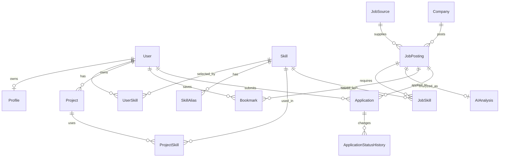

# DevJob ERD (설계 예정)

## 1. 범위와 설계 판단

이 문서는 `requirements.md`, `user-flow.md`, `ui-spec.md`, `architecture.md`, `development-plan.md`에 명시된 **MVP 데이터 구조의 설계안**이다. S03의 `User`, S04의 `Profile`, S05의 `Skill`·`SkillAlias`·`UserSkill`, S07의 `Company`·`JobSource`·`JobPosting`을 Entity와 migration으로 구현했으며 나머지는 설계 예정이다. DB는 `architecture.md`의 PostgreSQL을 전제로 한다.

S01에서 스키마 적용은 Flyway SQL migration + JPA `validate`로 확정했다. S01은 연결 기반과 Flyway 이력 테이블만 구성하며, 아래 도메인 테이블은 후속 단계에서 Entity와 migration을 함께 구현한다.

통합 migration 순서는 S03 `V1__create_users.sql` → S07 `V2__create_job_collection.sql` → S04 `V3__create_profiles.sql` → S05 `V4__create_skills.sql`이다. 기존 개발 DB의 Flyway 이력은 비어 있고, S03 검증 DB는 V1, S07 검증 DB는 V1·V2가 적용되어 있었다. S05 격리 DB에는 기술 생성이 V3으로 이미 적용되어 있으므로 통합본을 그대로 실행하면 Flyway 검증이 실패한다. 각 DB의 이력을 확인하고 이력 수정·DB 초기화를 자동으로 수행하지 않는다.

S07에서 `Company`·`JobSource`·`JobPosting`의 Entity·Repository를 구현했다. 아래 필드·관계·유일 키 계약을 유지하며 PostgreSQL 17에서 Flyway 적용과 JPA `validate`를 확인했다. 출처·외부 ID 중복은 기존 공고와 회사 연결을 보존한다. 신규 공고는 회사 고유 식별 근거가 없으므로 별도 Company를 연결하고 회사명만으로 기존 기업을 합치지 않는다. AI·CRM 테이블은 이 단계에 포함하지 않는다.

| 판단 지점 | MVP 결정과 근거 |
| --- | --- |
| 사용자와 프로필 | `User`에는 인증용 이메일과 비밀번호 해시를, `Profile`에는 취업 정보를 둔다. 이메일을 두 테이블에 중복 저장하지 않는다. 프로필은 가입 직후 아직 없을 수 있어 `User` 1 : `Profile` 0..1로 둔다. |
| 기술 정규화 | 표준 `Skill`과 입력 표현 `SkillAlias`를 분리한다. 사용자·프로젝트·공고가 같은 표준 기술을 참조하므로 비교와 집계에 문자열 중복이 생기지 않는다. |
| 채용 출처와 중복 | 아키텍처의 `JobSource`를 출처 기준으로 사용하고 `(job_source_id, external_id)`를 유일하게 둔다. 회사명·제목·설명 기반 보조 식별은 필요한 경우 검토하며 MVP의 추가 유일성 제약으로 확정하지 않는다. |
| AI 분석 | 공고당 현재 분석 결과 하나만 저장한다. 상태와 검증된 결과는 `AIAnalysis`, 정규화된 기술 관계는 `JobSkill`에 둔다. 실패한 원시 LLM 응답은 정상 결과로 저장하지 않는다. 재시도는 같은 분석 행을 갱신한다. |
| 관심 공고와 지원 | `Bookmark`와 `Application`은 독립적이다. `INTERESTED` 지원 상태가 있어도 북마크를 강제 생성하지 않는다. 사용자·공고당 각각 최대 한 건으로 단순화한다. |
| 지원 이력 | 요구사항의 “상태가 변경될 때마다”를 기준으로 최초 상태 등록과 이후 변경을 `ApplicationStatusHistory`에 기록한다. 아키텍처의 “필요한 경우”보다 구체적인 요구사항을 따른다. |
| 파생 데이터 | 적합도·Skill Gap·기본 학습 우선순위·시장 수요·대시보드 집계는 기존 데이터에서 계산한다. 별도 결과 테이블과 자유 입력 할 일 테이블은 만들지 않는다. |

`ui-spec.md`의 이력서·알림·확장형 캐릭터 화면은 현재 MVP 기능 범위를 넓히는 DB 근거로 사용하지 않는다. 학습 우선순위는 `user-flow.md`와 `development-plan.md`의 **기본 규칙 기반 계산**까지만 MVP에 포함한다.

## 2. 관계 개요

관계의 의미: `User`–`Skill`, `Project`–`Skill`, `JobPosting`–`Skill`, `User`–`JobPosting`(북마크 및 지원)은 각각 N:M이며 아래 중간 테이블을 통해 표현한다. 회사·출처 하나에는 공고가 여러 개 올 수 있다. `ApplicationStatusHistory`는 지원 한 건의 1:N 기록이다.

## 3. MVP 엔티티

표의 `id`는 각 테이블의 PK다. `*_id`는 별도 표기가 없으면 이름에 대응하는 테이블의 `id`를 참조하는 FK다. 주요 컬럼만 나열하며 생성·수정 시각 등 공통 운영 컬럼은 필요한 테이블에 포함한다.

### 3.1 계정, 역량, 프로젝트

S03 물리 매핑: `User`는 `users` 테이블로 구현한다. `id`는 BIGINT identity, `email`은 VARCHAR(254), `password_hash`는 VARCHAR(100), `created_at`은 TIMESTAMP WITH TIME ZONE이며 모두 필수다. `V1__create_users.sql`은 정규화된 이메일의 UNIQUE와 `email = lower(btrim(email))` CHECK를 적용한다. 서버 세션은 메모리에 보관하며 인증용 DB 테이블은 추가하지 않는다. 기존 데이터 삭제·변경 migration은 없다.

S04 물리 매핑: `V3__create_profiles.sql`은 `profiles`를 새로 만들고 `user_id`의 FK·UNIQUE로 사용자당 0..1건을 보장한다. 이메일은 `users.email`에만 저장한다. 프로필은 `id` BIGINT identity, `name` VARCHAR(100) 필수, 희망 직무·경력·지역 각 VARCHAR(100), 자기소개 VARCHAR(2000), 학력·자격증 각 VARCHAR(1000), `updated_at` TIMESTAMP WITH TIME ZONE 필수다. 기존 테이블이나 데이터를 변경하지 않는다.

| 엔티티 | 목적 | 주요 컬럼 및 키 | 핵심 제약 |
| --- | --- | --- | --- |
| `User` | 계정과 인증 주체 | `id` PK, `email`, `password_hash`, `created_at` | `email` 필수·유일, 비밀번호 원문 저장 금지 |
| `Profile` | 사용자 취업 프로필 | `id` PK, `user_id` FK, `name`, `desired_role`, `career_level`, `desired_location`, `introduction`, `education`, `certifications`, `updated_at` | `user_id` 필수·유일; 초기 설정 전에는 행이 없어도 됨. 학력·자격증은 사용자 흐름의 선택 입력을 별도 엔티티 없이 담음 |
| `Skill` | 표준 기술명 | `id` PK, `name` | 정규화한 기술명 기준 유일 |
| `SkillAlias` | 여러 입력 이름을 표준 기술에 연결 | `id` PK, `skill_id` FK, `alias_name` | `skill_id`, `alias_name` 필수; 정규화한 별칭은 하나의 `Skill`만 가리킴 |
| `UserSkill` | 사용자가 보유한 기술 | `id` PK, `user_id` FK, `skill_id` FK, `created_at` | `(user_id, skill_id)` 유일 |
| `Project` | 사용자 프로젝트 경험 | `id` PK, `user_id` FK, `name`, `description`, `start_date`, `end_date`, `role`, `key_features`, `outcome`, `project_url`, `created_at`, `updated_at` | `user_id`, `name` 필수; 종료일이 있으면 시작일보다 빠를 수 없음 |
| `ProjectSkill` | 프로젝트에서 사용한 기술 | `id` PK, `project_id` FK, `skill_id` FK | `(project_id, skill_id)` 유일 |

`UserSkill`과 `ProjectSkill`이 필요한 이유는 한 사용자가 여러 기술을, 한 기술을 여러 사용자가 보유할 수 있고 프로젝트에도 같은 N:M 관계가 있기 때문이다. 역량 비교에는 `UserSkill`과 사용자의 `ProjectSkill`을 합친 기술 집합을 사용한다. 프로젝트 기술을 추가해도 `UserSkill` 행을 자동 생성하지는 않는다.

S05 물리 매핑: `skill`, `skill_alias`, `user_skill`의 ID는 BIGINT identity다. 기술 `name`·별칭 `alias_name`과 각 `normalized_name`은 필수 VARCHAR(100), 공백만 있는 값은 CHECK로 거부한다. `normalized_name`은 애플리케이션의 NFKC·공백 축약·ROOT 소문자 키를 저장하고 각 테이블에서 UNIQUE다. 표준명도 `skill_alias`에 등록해 모든 입력 표현을 하나의 별칭 키 공간에 예약한다. 서비스는 충돌 시 다른 Skill을 생성하지 않고 정규화 ID를 재사용한다. `skill_alias.skill_id`, `user_skill.user_id`·`skill_id`는 필수 FK이고 UserSkill은 TIMESTAMPTZ `created_at`과 `(user_id, skill_id)` UNIQUE를 갖는다. 사용자 기술 삭제는 관계만 지우며 FK cascade는 사용하지 않는다.

`V4__create_skills.sql`은 위 세 테이블과 16개 초기 기술·표준명 별칭 16개·추가 별칭 7개를 생성한다. S05 작업 DB에는 같은 SQL이 V3으로 적용되어 있으므로 해당 DB에는 통합본을 직접 적용하지 않는다. 기존 이력은 수정하지 않았으며 상세 검증·통합 주의사항은 [S05 보고](s05-implementation-report.md)를 따른다.

### 3.2 채용공고와 AI 분석

| 엔티티 | 목적 | 주요 컬럼 및 키 | 핵심 제약 |
| --- | --- | --- | --- |
| `Company` | 공고를 게시한 기업 | `id` PK, `name` | `name` 필수; 동명 기업 가능성을 고려해 이름만으로 유일성을 강제하지 않음 |
| `JobSource` | 공식 채용 데이터 출처 | `id` PK, `code`, `name` | `code` 필수·유일; MVP 출처는 Work24, Saramin은 공식 사용 조건을 충족한 이후 추가 |
| `JobPosting` | 외부 공고의 정규화된 원문·기본 정보 | `id` PK, `job_source_id` FK, `external_id`, `company_id` FK, `title`, `description`, `employment_type`, `career_requirement`, `location`, `posted_date`, `deadline_date`, `source_url`, `created_at`, `updated_at` | 출처·외부 ID·회사·제목·원문 URL 필수; `(job_source_id, external_id)` 유일. 마감일이 있으면 게시일보다 빠를 수 없음 |
| `AIAnalysis` | 공고별 현재 분석 상태와 검증된 구조화 결과 | `id` PK, `job_posting_id` FK, `status`, `result_json`, `failure_reason`, `analyzed_at`, `updated_at` | `job_posting_id` 필수·유일; `status ∈ {PENDING, COMPLETED, FAILED}`. `COMPLETED` 결과만 검증·정규화해 저장; 실패 시 공고 본문은 유지 |
| `JobSkill` | 공고의 정규화된 요구 기술 | `id` PK, `job_posting_id` FK, `skill_id` FK, `requirement_type` | `(job_posting_id, skill_id)` 유일; `requirement_type ∈ {REQUIRED, PREFERRED}` |

`JobSkill`은 공고와 기술 간 N:M 관계에 필수·우대 구분을 추가한다. 한 공고에서 같은 기술이 필수와 우대로 모두 추출되면 `REQUIRED` 한 행으로 정규화한다. `JobSkill`은 유효한 분석이 완료된 뒤 저장하며, 분석 전이거나 실패한 공고는 기술 행이 없어도 기본 정보 조회가 가능하다. `AIAnalysis.result_json`은 검증을 통과한 구조화 결과만 보관하고, 비교·집계는 `JobSkill`을 기준으로 한다. 무효한 응답을 재사용 가능한 결과로 취급하지 않는다.

### 3.3 관심 공고와 지원 관리

| 엔티티 | 목적 | 주요 컬럼 및 키 | 핵심 제약 |
| --- | --- | --- | --- |
| `Bookmark` | 사용자별 관심 공고 | `id` PK, `user_id` FK, `job_posting_id` FK, `created_at` | `(user_id, job_posting_id)` 유일 |
| `Application` | 공고별 현재 지원 상황 | `id` PK, `user_id` FK, `job_posting_id` FK, `current_status`, `applied_date`, `next_schedule_at`, `note`, `created_at`, `updated_at` | `(user_id, job_posting_id)` 유일; 상태는 아래 허용값 중 하나 |
| `ApplicationStatusHistory` | 지원 상태 변경 기록 | `id` PK, `application_id` FK, `from_status`, `to_status`, `changed_at` | `to_status`, `changed_at` 필수; 최초 등록 시 `from_status`는 비움; 상태가 실제 변경될 때마다 한 행 추가 |

`Bookmark`와 `Application`은 각각 사용자와 공고 사이의 관계에 별도 의미와 속성이 있어 중간 테이블로 둔다. `Application.current_status`의 허용값은 `INTERESTED`, `PLANNED`, `APPLIED`, `DOCUMENT_PASSED`, `INTERVIEW`, `FINAL_PASSED`, `REJECTED`, `WITHDRAWN`이다. 지원일은 실제 지원을 기록할 때 사용하며, 메모와 다음 일정은 사용자 흐름에 있는 선택 정보다. 상태의 전이 가능 여부는 `user-flow.md`를 따르며 DB의 허용값 제약만으로 전이 규칙을 대신하지 않는다.

## 4. 공통 제약과 조회 기준

- 모든 FK는 존재하는 부모를 참조해야 한다. 사용자 소유 데이터는 인증된 사용자 ID를 기준으로 조회·수정 권한을 검사한다. 공고·기술·회사·출처는 사용자별로 복제하지 않는 공통 데이터다.
- 이메일·기술명·별칭은 입력 표기의 대소문자 차이 때문에 중복되지 않도록 정규화 비교를 적용한다. 구체적인 인덱스·마이그레이션 표현은 구현 단계에서 PostgreSQL에 맞춰 정한다.
- 사용자 또는 공고의 삭제 정책은 현재 문서에서 확정되지 않았다. MVP 설계는 연관 기록을 암묵적으로 대량 삭제하지 않으며, 삭제 기능을 구현할 때 관련 이력의 보존 정책을 먼저 결정한다.
- 검색 필터는 `JobPosting` 기본 필드와 `Company`, `JobSkill` 조인으로 구성한다. MVP의 직무 필터는 별도 직무 테이블 없이 공고 제목으로 좁힌다. 시장 기술 수요는 완료된 공고의 `JobSkill` 집계, 역량 비교는 `UserSkill`·`ProjectSkill`과 `JobSkill`의 비교로 계산한다.

## 5. MVP 이후 확장 영역

공식 채용 출처 추가, 의미 기반 매칭·추천, 이력서 분석, 복잡한 게이미피케이션, 알림, 독립적인 할 일·일정 관리는 현재 테이블에 포함하지 않는다. 향후 요구사항과 아키텍처가 확정되면 별도 설계한다. 현재의 `JobSource`, 공통 `Skill`, 사용자·공고·프로젝트 관계는 확장 시 재사용할 수 있다.
