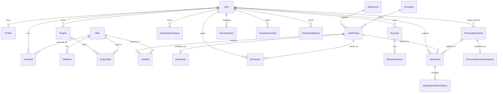

# DevJob ERD (설계 예정)

## 1. 범위와 설계 판단

이 문서는 `requirements.md`, `user-flow.md`, `ui-spec.md`, `architecture.md`, `development-plan.md`에 명시된 **MVP 데이터 구조의 설계안**이다. S03의 `User`, S04의 `Profile`, S05의 `Skill`·`SkillAlias`·`UserSkill`, S06의 `Project`·`ProjectSkill`, S07의 `Company`·`JobSource`·`JobPosting`, S10의 `Bookmark`, S11의 `Application`·`ApplicationStatusHistory`와 추가 개인 관심공고 `PersonalSavedJob`을 Entity와 migration으로 구현했다. DB는 `architecture.md`의 PostgreSQL을 전제로 한다.

S01에서 스키마 적용은 Flyway SQL migration + JPA `validate`로 확정했다. S01은 연결 기반과 Flyway 이력 테이블만 구성하며, 아래 도메인 테이블은 후속 단계에서 Entity와 migration을 함께 구현한다.

통합 migration 순서는 S03 `V1__create_users.sql` → S07 `V2__create_job_collection.sql` → S04 `V3__create_profiles.sql` → S05 `V4__create_skills.sql` → S06 `V5__create_projects.sql` → S10 `V6__create_bookmarks.sql` → S11 `V7__create_applications.sql`이다. 기존 개발 DB의 Flyway 이력은 비어 있고 S06·S10·S11의 tmpfs 검증 DB는 재기동 후 이력 테이블이 없는 상태였다. S05 격리 DB에는 기술 생성이 V3으로 이미 적용되어 있으므로 통합본을 그대로 실행하면 Flyway 검증이 실패한다. 각 DB의 이력을 확인하고 이력 수정·DB 초기화를 자동으로 수행하지 않는다.

S07에서 `Company`·`JobSource`·`JobPosting`의 Entity·Repository를 구현했다. 아래 필드·관계·유일 키 계약을 유지하며 PostgreSQL 17에서 Flyway 적용과 JPA `validate`를 확인했다. 출처·외부 ID 중복은 기존 공고와 회사 연결을 보존한다. 신규 공고는 회사 고유 식별 근거가 없으므로 별도 Company를 연결하고 회사명만으로 기존 기업을 합치지 않는다. AI·CRM 테이블은 이 단계에 포함하지 않는다.

S09는 기존 스키마를 재사용한다. 공채속보의 JobSource.code는 `WORK24_OPEN_RECRUITMENT`, external_id는 공식 `empSeqno`다. 회사·제목·원문 URL과 고용형태 표시값만 목록에서 매핑하며 본문·경력·지역·게시일·마감일은 null이다. 일반 채용정보 출처와 ID 공간을 합치지 않는다. 새 migration 없이 반복·동시 수집과 외부 장애 격리를 일회용 PostgreSQL에서 검증했다.

S11 단독 worktree는 당시 V1~V4 뒤에 V5 지원 migration을 적용해 검증했다. main 통합에서는 프로젝트 V5·북마크 V6 다음의 V7로 배치했다. 기존 개발 DB에는 적용하지 않았다.

| 판단 지점 | MVP 결정과 근거 |
| --- | --- |
| 사용자와 프로필 | `User`에는 인증용 이메일과 비밀번호 해시를, `Profile`에는 취업 정보를 둔다. 이메일을 두 테이블에 중복 저장하지 않는다. 프로필은 가입 직후 아직 없을 수 있어 `User` 1 : `Profile` 0..1로 둔다. |
| 기술 정규화 | 표준 `Skill`과 입력 표현 `SkillAlias`를 분리한다. 사용자·프로젝트·공고가 같은 표준 기술을 참조하므로 비교와 집계에 문자열 중복이 생기지 않는다. |
| 채용 출처와 중복 | 아키텍처의 `JobSource`를 출처 기준으로 사용하고 `(job_source_id, external_id)`를 유일하게 둔다. 회사명·제목·설명 기반 보조 식별은 필요한 경우 검토하며 MVP의 추가 유일성 제약으로 확정하지 않는다. |
| AI 분석 | 공고당 현재 분석 결과 하나만 저장한다. 상태와 검증된 결과는 `AIAnalysis`, 정규화된 기술 관계는 `JobSkill`에 둔다. 실패한 원시 LLM 응답은 정상 결과로 저장하지 않는다. 재시도는 같은 분석 행을 갱신한다. |
| 관심 공고와 지원 | `Bookmark`와 `Application`은 독립적이다. `INTERESTED` 지원 상태가 있어도 북마크를 강제 생성하지 않는다. 사용자·공고당 각각 최대 한 건으로 단순화한다. |
| 지원 이력 | 요구사항의 “상태가 변경될 때마다”를 기준으로 최초 상태 등록과 이후 변경을 `ApplicationStatusHistory`에 기록한다. 아키텍처의 “필요한 경우”보다 구체적인 요구사항을 따른다. |
| 파생 데이터 | 적합도·Skill Gap·기본 학습 우선순위·시장 수요·기존 대시보드 `nextActions`는 기존 데이터에서 계산한다. B03의 개인 할 일은 별도 `personal_todo`에 저장한다. |

`ui-spec.md`의 이력서·알림·확장형 캐릭터 화면은 현재 MVP 기능 범위를 넓히는 DB 근거로 사용하지 않는다. 학습 우선순위는 `user-flow.md`와 `development-plan.md`의 **기본 규칙 기반 계산**까지만 MVP에 포함한다.

## 2. 관계 개요

관계의 의미: `User`–`Skill`, `Project`–`Skill`, `JobPosting`–`Skill`, `User`–`JobPosting`(북마크 및 지원)은 각각 N:M이며 아래 중간 테이블을 통해 표현한다. 회사·출처 하나에는 공고가 여러 개 올 수 있다. `ApplicationStatusHistory`는 지원 한 건의 1:N 기록이다.

## 3. MVP 엔티티

표의 `id`는 각 테이블의 PK다. `*_id`는 별도 표기가 없으면 이름에 대응하는 테이블의 `id`를 참조하는 FK다. 주요 컬럼만 나열하며 생성·수정 시각 등 공통 운영 컬럼은 필요한 테이블에 포함한다.

### 3.1 계정, 역량, 프로젝트

S03 물리 매핑: `User`는 `users` 테이블로 구현한다. `id`는 BIGINT identity, `email`은 VARCHAR(254), `password_hash`는 VARCHAR(100), `created_at`은 TIMESTAMP WITH TIME ZONE이며 모두 필수다. `V1__create_users.sql`은 정규화된 이메일의 UNIQUE와 `email = lower(btrim(email))` CHECK를 적용한다. 서버 세션은 메모리에 보관하며 인증용 DB 테이블은 추가하지 않는다. 기존 데이터 삭제·변경 migration은 없다.

B01에서는 `users.credential_version` BIGINT NOT NULL DEFAULT 0을 V12 migration으로 추가한다. 비밀번호 변경 트랜잭션에서 사용자 행을 잠그고 BCrypt 해시 갱신과 버전 증가를 함께 커밋한다. 로그인한 세션에는 당시 버전을 기록하며, 보호 API 요청마다 저장된 버전과 비교한다. 기존 세션에 버전 기록이 없으면 0으로 간주하므로 첫 변경 이후에는 거절된다. 세션 자체는 계속 메모리에 두며 별도 세션 테이블이나 비밀번호 이력은 만들지 않는다.

S04 물리 매핑: `V3__create_profiles.sql`은 `profiles`를 새로 만들고 `user_id`의 FK·UNIQUE로 사용자당 0..1건을 보장한다. 이메일은 `users.email`에만 저장한다. 프로필은 `id` BIGINT identity, `name` VARCHAR(100) 필수(현재 API·Entity에서는 닉네임으로 사용), 희망 직무·경력·지역 각 VARCHAR(100), 자기소개 VARCHAR(2000), 학력·자격증 각 VARCHAR(1000), `updated_at` TIMESTAMP WITH TIME ZONE 필수다. 기존 테이블이나 데이터를 변경하지 않는다.

| 엔티티 | 목적 | 주요 컬럼 및 키 | 핵심 제약 |
| --- | --- | --- | --- |
| `User` | 계정과 인증 주체 | `id` PK, `email`, `password_hash`, `created_at` | `email` 필수·유일, 비밀번호 원문 저장 금지 |
| `Profile` | 사용자 취업 프로필 | `id` PK, `user_id` FK, `name`(닉네임), `desired_role`, `career_level`, `desired_location`, `introduction`, `education`, `certifications`, `updated_at` | `user_id` 필수·유일; 초기 설정 전에는 행이 없어도 됨. 학력·자격증은 사용자 흐름의 선택 입력을 별도 엔티티 없이 담음 |
| `Skill` | 표준 기술명 | `id` PK, `name` | 정규화한 기술명 기준 유일 |
| `SkillAlias` | 여러 입력 이름을 표준 기술에 연결 | `id` PK, `skill_id` FK, `alias_name` | `skill_id`, `alias_name` 필수; 정규화한 별칭은 하나의 `Skill`만 가리킴 |
| `UserSkill` | 사용자가 보유한 기술 | `id` PK, `user_id` FK, `skill_id` FK, `created_at`, `proficiency_level`, `experience_months` | `(user_id, skill_id)` 유일; 숙련도 1~5 또는 null, 경험 개월 0~600 또는 null |
| `Project` | 사용자 프로젝트 경험 | `id` PK, `user_id` FK, `name`, `description`, `start_date`, `end_date`, `role`, `key_features`, `outcome`, `project_url`, `created_at`, `updated_at` | `user_id`, `name`, `start_date` 필수; 종료일이 있으면 시작일보다 빠를 수 없음 |
| `ProjectSkill` | 프로젝트에서 사용한 기술 | `id` PK, `project_id` FK, `skill_id` FK | `(project_id, skill_id)` 유일 |

`UserSkill`과 `ProjectSkill`이 필요한 이유는 한 사용자가 여러 기술을, 한 기술을 여러 사용자가 보유할 수 있고 프로젝트에도 같은 N:M 관계가 있기 때문이다. 역량 비교에는 `UserSkill`과 사용자의 `ProjectSkill`을 합친 기술 집합을 사용한다. 프로젝트 기술을 추가해도 `UserSkill` 행을 자동 생성하지는 않는다.

S05 물리 매핑: `skill`, `skill_alias`, `user_skill`의 ID는 BIGINT identity다. 기술 `name`·별칭 `alias_name`과 각 `normalized_name`은 필수 VARCHAR(100), 공백만 있는 값은 CHECK로 거부한다. `normalized_name`은 애플리케이션의 NFKC·공백 축약·ROOT 소문자 키를 저장하고 각 테이블에서 UNIQUE다. 표준명도 `skill_alias`에 등록해 모든 입력 표현을 하나의 별칭 키 공간에 예약한다. 서비스는 충돌 시 다른 Skill을 생성하지 않고 정규화 ID를 재사용한다. `skill_alias.skill_id`, `user_skill.user_id`·`skill_id`는 필수 FK이고 UserSkill은 TIMESTAMPTZ `created_at`과 `(user_id, skill_id)` UNIQUE를 갖는다. 사용자 기술 삭제는 관계만 지우며 FK cascade는 사용하지 않는다.

`V4__create_skills.sql`은 위 세 테이블과 16개 초기 기술·표준명 별칭 16개·추가 별칭 7개를 생성한다. S05 작업 DB에는 같은 SQL이 V3으로 적용되어 있으므로 해당 DB에는 통합본을 직접 적용하지 않는다. 기존 이력은 수정하지 않았으며 상세 검증·통합 주의사항은 [S05 보고](s05-implementation-report.md)를 따른다.

B02 물리 매핑: main 통합 순서에 맞춘 `V13__user_skill_experience.sql`은 기존 `user_skill`에 nullable INTEGER `proficiency_level`·`experience_months`와 각각 1~5·0~600 CHECK만 추가한다. 기존 행은 두 값이 null이며 기존 행·migration은 변경하지 않는다. 사용자 기술 관계 삭제 시 값도 함께 삭제되고 재등록은 새 null 관계다. 프로젝트 기술은 값을 자동 생성하거나 합산하지 않으며 적합도·Skill Gap의 기술 집합 계산은 그대로다.

S06 물리 매핑: `V5__create_projects.sql`은 `project`·`project_skill`만 추가한다. ID는 BIGINT identity, 프로젝트의 `user_id`는 users FK, 이름은 필수 VARCHAR(100)·공백 검사, 역할은 VARCHAR(100), 설명·주요 기능·성과·URL은 VARCHAR(2000)이다. 시작일은 필수 DATE, 종료일은 선택 DATE·날짜 순서 CHECK, 생성·수정 시각은 필수 TIMESTAMPTZ다. 목록을 위해 `(user_id, created_at DESC, id DESC)` 인덱스를 둔다. ProjectSkill은 두 필수 FK와 `(project_id, skill_id)` UNIQUE, `skill_id` 인덱스를 갖는다. FK cascade 없이 서비스 트랜잭션과 JPA orphan removal로 해당 프로젝트 관계를 삭제한다. 수정·삭제는 프로젝트 행 잠금으로 직렬화한다. 기존 테이블·데이터·migration 이력은 변경하지 않는다.

### 3.2 채용공고와 AI 분석

| 엔티티 | 목적 | 주요 컬럼 및 키 | 핵심 제약 |
| --- | --- | --- | --- |
| `Company` | 공고를 게시한 기업 | `id` PK, `name` | `name` 필수; 동명 기업 가능성을 고려해 이름만으로 유일성을 강제하지 않음 |
| `JobSource` | 공식 채용 데이터 출처 | `id` PK, `code`, `name` | `code` 필수·유일; 출처는 Work24와 ALIO_RECRUITMENT를 구분 |
| `JobPosting` | 외부 공고의 정규화된 원문·기본 정보 | `id` PK, `job_source_id` FK, `external_id`, `company_id` FK, `title`, `description`, `employment_type`, `career_requirement`, `location`, `posted_date`, `deadline_date`, `source_url`, `created_at`, `updated_at` | 출처·외부 ID·회사·제목·원문 URL 필수; `(job_source_id, external_id)` 유일. 마감일이 있으면 게시일보다 빠를 수 없음 |
| `job_collection_run` | ALIO 관리자 수동 배치의 마지막 실행 상태 | `source_code` PK, `run_id` UUID, `status`, 시작·갱신·종료 시각, 처리 페이지·생성·중복·거절·실패 건수, `source_error` | 출처별 한 행; 모든 건수는 0 이상. 10분 이상 갱신되지 않은 RUNNING은 다음 명시적 실행으로 교체 가능 |
| `JobRecruitmentStep` | 청년일자리 공고의 전형 단계 | `job_posting_id`·`external_id` 복합 PK, `sort_order`, `title`, `openings`, `applicants`, `competition_rate`, `event_date` | 공고 FK는 삭제 시 단계 메타정보만 함께 삭제 |
| `JobRecruitmentAttachment` | 청년일자리 공고의 첨부파일 메타정보 | `job_posting_id`·`external_id` 복합 PK, `sort_order`, `name`, `file_type`, `url` | 파일 본문은 저장하지 않음; 공고 FK는 삭제 시 메타정보만 함께 삭제 |
| `AIAnalysis` | 공고별 현재 분석 상태와 검증된 구조화 결과 | `id` PK, `job_posting_id` FK, `status`, `result_json`, `failure_reason`, `analyzed_at`, `updated_at` | `job_posting_id` 필수·유일; `status ∈ {PENDING, COMPLETED, FAILED}`. `COMPLETED` 결과만 검증·정규화해 저장; 실패 시 공고 본문은 유지 |
| `JobSkill` | 공고의 정규화된 요구 기술 | `id` PK, `job_posting_id` FK, `skill_id` FK, `requirement_type` | `(job_posting_id, skill_id)` 유일; `requirement_type ∈ {REQUIRED, PREFERRED}` |

`JobSkill`은 공고와 기술 간 N:M 관계에 필수·우대 구분을 추가한다. 한 공고에서 같은 기술이 필수와 우대로 모두 추출되면 `REQUIRED` 한 행으로 정규화한다. `JobSkill`은 유효한 분석이 완료된 뒤 저장하며, 분석 전이거나 실패한 공고는 기술 행이 없어도 기본 정보 조회가 가능하다. `AIAnalysis.result_json`은 검증을 통과한 구조화 결과만 보관하고, 비교·집계는 `JobSkill`을 기준으로 한다. 무효한 응답을 재사용 가능한 결과로 취급하지 않는다.

S12 물리 매핑: `V8__create_job_analysis.sql`은 기존 V1~V7 뒤에 `ai_analysis`와 `job_skill`만 추가한다. `ai_analysis.job_posting_id`는 필수·유일 FK, `status`는 세 상태만 허용하고 `result_json`은 JSONB, `updated_at`은 필수 TIMESTAMPTZ다. `job_skill`은 공고·기술 FK와 `(job_posting_id, skill_id)` UNIQUE, 기술 ID 인덱스를 갖는다. AI가 검증된 미등록 기술명을 반환하면 공통 `skill`·`skill_alias`에도 행이 추가될 수 있으며 기존 migration·데이터는 수정하지 않는다. 분석 요청과 완료 쓰기는 공고 행 잠금으로 직렬화하고 완료 결과는 재사용한다.

### 3.3 관심 공고와 지원 관리

S10 물리 매핑: `V6__create_bookmarks.sql`은 `bookmark` 테이블만 추가한다. `id`는 BIGINT identity, `user_id`·`job_posting_id`는 필수 FK, `created_at`은 필수 TIMESTAMPTZ이며 DB 현재 시각을 기본값으로 사용한다. `(user_id, job_posting_id)` UNIQUE로 동시 중복을 방지하고 `(user_id, created_at DESC, id DESC)` 인덱스로 사용자별 저장순 목록을 지원한다. FK cascade는 없으며 해제는 해당 사용자·공고 관계만 삭제한다. 기존 테이블·데이터·migration은 변경하지 않는다.

S11 물리 매핑: `V7__create_applications.sql`은 기존 데이터를 변경하지 않고 `application`, `application_status_history` 두 테이블을 추가한다. ID는 BIGINT identity, FK는 필수이며 cascade 삭제는 없다. `application`은 `(user_id, job_posting_id)` UNIQUE, 상태 VARCHAR(30) CHECK, 지원일 DATE, 다음 일정·생성·수정 시각 TIMESTAMPTZ, 메모 VARCHAR(2000)이다. 실제 지원 이후 상태의 지원일은 DB CHECK로도 필수다. 이력은 from/to 상태 VARCHAR(30) CHECK, 변경 시각 TIMESTAMPTZ 필수이며 최초 from만 null이다. 사용자·상태·등록 시각·ID 목록 인덱스와 지원·변경 시각·ID 이력 인덱스를 둔다. 서비스가 초기·전이 이력을 같은 트랜잭션에 저장하고 수정 시 행 잠금으로 동시 상태 변경을 보호한다.

`V29__soft_delete_applications.sql`은 `application.deleted_at`을 추가하고 수집·개인 공고별 유일 키를 활성 행(`deleted_at IS NULL`)의 부분 인덱스로 바꾼다. 삭제한 지원의 이력과 면접 FK는 유지하고, 활성 지원 조회에는 `deleted_at IS NULL`을 적용한다. 삭제 후 같은 공고를 다시 등록할 수 있다.

| 엔티티 | 목적 | 주요 컬럼 및 키 | 핵심 제약 |
| --- | --- | --- | --- |
| `Bookmark` | 사용자별 관심 공고 | `id` PK, `user_id` FK, `job_posting_id` FK, `created_at` | `(user_id, job_posting_id)` 유일 |
| `PersonalSavedJob` | 사용자 직접 등록 개인 관심공고 | `id` PK, `user_id` FK, `url`, `company_name`, `title`, `role`, `career_level`, `location`, `employment_type`, `deadline_date`, `note`, `description`, `created_at`, `updated_at`, `deleted_at` | 활성 `(user_id, url)` 부분 UNIQUE. 삭제는 `deleted_at`을 채워 이력 보존 |
| `PersonalSavedJobAnalysis` | 사용자가 붙여넣은 개인 공고 본문의 AI 분석 | `personal_saved_job_id` PK·FK, `status`, `result_json`, `failure_reason`, `analyzed_at`, `updated_at` | 개인 공고당 최대 한 행. 제목·본문 수정 시 기존 결과 삭제 |
| `Application` | 공고별 현재 지원 상황 | `id` PK, `user_id` FK, nullable `job_posting_id` FK, nullable `personal_saved_job_id` FK, `current_status`, `applied_date`, `next_schedule_at`, `note`, `created_at`, `updated_at`, `deleted_at` | 두 공고 FK 중 정확히 하나만 값; 사용자·공고 종류별 활성 행 유일; 상태는 아래 허용값 중 하나 |
| `ApplicationStatusHistory` | 지원 상태 변경 기록 | `id` PK, `application_id` FK, `from_status`, `to_status`, `changed_at` | `to_status`, `changed_at` 필수; 최초 등록 시 `from_status`는 비움; 상태가 실제 변경될 때마다 한 행 추가 |

`Bookmark`와 `Application`은 각각 사용자와 공고 사이의 관계에 별도 의미와 속성이 있어 중간 테이블로 둔다. `Application.current_status`의 허용값은 `INTERESTED`, `PLANNED`, `APPLIED`, `DOCUMENT_PASSED`, `INTERVIEW`, `FINAL_PASSED`, `REJECTED`, `WITHDRAWN`이다. 지원일은 실제 지원을 기록할 때 사용하며, 메모와 다음 일정은 사용자 흐름에 있는 선택 정보다. 상태의 전이 가능 여부는 `user-flow.md`를 따르며 DB의 허용값 제약만으로 전이 규칙을 대신하지 않는다.

`V10__personal_saved_jobs.sql`은 공용 `JobPosting`/`Bookmark`를 변경하지 않고 `personal_saved_job`을 추가한다. 기존 `application.job_posting_id`는 nullable로 바뀌지만 기존 행은 그대로 유지한다. `ck_application_one_job`과 개인 공고별 부분 UNIQUE가 두 참조를 보호한다. `V11__personal_saved_job_analysis.sql`은 개인 공고 본문과 별도 분석 테이블을 추가한다. 개인 공고는 `JobSource`나 공용 `ai_analysis`·`job_skill`에 연결하지 않는다.

## 4. 공통 제약과 조회 기준

- 모든 FK는 존재하는 부모를 참조해야 한다. 사용자 소유 데이터는 인증된 사용자 ID를 기준으로 조회·수정 권한을 검사한다. 공고·기술·회사·출처는 사용자별로 복제하지 않는 공통 데이터다.
- 이메일·기술명·별칭은 입력 표기의 대소문자 차이 때문에 중복되지 않도록 정규화 비교를 적용한다. 구체적인 인덱스·마이그레이션 표현은 구현 단계에서 PostgreSQL에 맞춰 정한다.
- 공용 공고 자체의 삭제 정책은 여전히 미정이다. B15 계정 삭제는 아래 사용자 소유 행의 정책을 확정했다. 개별 리소스 삭제의 기존 소프트 삭제·보존 정책은 계정 삭제 전까지 그대로 적용한다.
- 검색 필터는 `JobPosting` 기본 필드와 `Company`, `JobSkill` 조인으로 구성한다. MVP의 직무 필터는 별도 직무 테이블 없이 공고 제목으로 좁힌다. 시장 기술 수요는 완료된 공고의 `JobSkill` 집계, 역량 비교는 `UserSkill`·`ProjectSkill`과 `JobSkill`의 비교로 계산한다.
- B08 경력·지역 분포는 공용 `JobPosting`의 기본 필드를, 기술 추이는 `AIAnalysis`가 `COMPLETED`인 공고의 `JobSkill` 관계를 읽기 전용으로 집계한다. `(job_source_id, external_id)`가 저장 공고 식별 단위이고 출처 간 동일 내용은 별개다. 집계 결과 테이블이나 migration은 추가하지 않는다. 새 공식 출처도 같은 공용 관계에 저장되면 집계에 포함한다.

## 5. MVP 이후 확장 영역

### B03 개인 할 일

`V14__personal_todos.sql`은 `personal_todo`를 추가한다. `id` BIGINT identity PK, `user_id` 필수 users FK, `title` 필수 VARCHAR(200)·공백 검사, `description` VARCHAR(2000), `due_at` TIMESTAMPTZ와 `due_time_zone` VARCHAR(100)은 둘 다 있거나 둘 다 없다. `completed_at`·`deleted_at`은 nullable TIMESTAMPTZ, `created_at`·`updated_at`은 필수 TIMESTAMPTZ다. 활성 목록 조회용 `(user_id, due_at ASC NULLS LAST, id DESC)` 부분 인덱스를 둔다. 서버는 `due_time_zone`의 IANA ID와 `due_at`의 요청 오프셋 일치를 검증한다. 완료 취소 시 `completed_at`을 비우고, 삭제 시 `deleted_at`을 채워 일반 조회에서 제외한다. 지원 기록·`nextActions`와 관계를 만들지 않는다. B10 `V23`는 기존 완료 Todo의 소급 차단용 `reward_eligible`을 추가한다.

`V30__todo_categories_and_reminders.sql`은 기존 행을 유지하며 `category` VARCHAR(30) 필수·기본 `기타`, `reminder_minutes` 정수·기본 1440을 추가한다. 알림 값은 -1·10·60·1440만 허용한다. 카테고리는 `personal_todo_category(id,user_id,name,icon_key,color_key,sort_order)`에 계정별로 저장하며 `(user_id,name)`을 유일하게 제한한다. `V31__todo_category_icons.sql`은 아이콘 키를 추가했고, `V32__todo_category_management.sql`은 색상·정렬 순서와 기본 8개 카테고리를 추가했다. `V33__todo_category_icon_and_sky_color.sql`은 단순화한 아이콘 5개와 하늘색 선택지를 추가하고, `V34__todo_category_reference_icons.sql`은 참고 스타일 아이콘 12개의 키를 허용한다. 신규 계정은 첫 카테고리 조회·할 일 생성 시 기본 8개를 시드한다. 서비스는 카테고리 총 20개 상한과 사용 중인 카테고리·마지막 카테고리 삭제 금지를 검사한다. 카테고리 이름 변경은 같은 트랜잭션에서 해당 계정의 할 일 이름도 갱신한다.

### B04 관심 기업의 별도 소유 모델

V35__interested_company_profile.sql은 기존 기업 행을 유지하며 industry VARCHAR(80), company_size enum 문자열(STARTUP/SMALL/MEDIUM/LARGE), region VARCHAR(80), interest_level enum 문자열(HIGH/MEDIUM/LOW, 기본 MEDIUM), favorite BOOLEAN(기본 false)을 추가한다. `interested_company_tag(company_id,position,tag)`는 기업별 최대 5개 태그의 순서를 저장하고 기업 삭제 시 함께 제거한다. `personal_company_tag(id,user_id,name)`은 사용자별 태그를 저장하며 (user_id,name)을 유일하게 제한한다. V36__company_tag_presentation.sql은 태그 색상 키와 정렬 순서를 추가하고 기존 계정에 기본 8개를 채운다. 신규 계정은 최초 조회 때 기본 8개를 저장하고 전체 최대 30개를 서비스에서 제한한다. 태그 이름 변경·삭제는 사용자 소유 기업의 연결에도 반영한다. 계정 삭제 시 기업 태그 연결을 기업보다 먼저, 사용자 태그를 사용자보다 먼저 삭제한다.

InterestedCompany는 사용자별 관심 기업 정보로 User 1:N이며 공고 수집용 공용 Company와 FK가 없다. id는 각각 독립된 ID 공간이다. B11 출처 확장도 공용 회사명을 사용자 기록과 자동 병합하지 않는다. 현재 JobPostingWriter는 신규 공고에 새 공용 Company를 연결하고, 같은 회사명만으로 공용 행끼리도 병합하지 않는다.

V15__create_interested_companies.sql은 interested_company만 추가한다. id BIGINT identity, user_id 필수 users FK, name 필수 VARCHAR(200), website_url 선택 VARCHAR(2048), note 선택 VARCHAR(2000), status 필수 VARCHAR(20) CHECK(INTERESTED, RESEARCHING, ARCHIVED), 생성·수정 시각 필수 TIMESTAMPTZ다. (user_id, website_url) UNIQUE는 웹사이트가 있는 기록의 사용자별 중복을 막는다. URL이 null인 동명 기록은 허용한다. 사용자별 목록에 (user_id, created_at DESC, id DESC) 인덱스를 사용한다. 삭제는 사용자 기록 한 건만 제거하고 공용 회사·공고 관계에는 영향이 없다. 기존 테이블·데이터를 변경하지 않는다.

### B05 이력서·불변 버전

`V16__resumes.sql`은 `resume`과 `resume_version`을 추가한다. `resume`은 BIGINT identity `id`, 필수 `user_id` FK, 공백 제외 필수 `title` VARCHAR(200), 필수 `created_at`·`updated_at` TIMESTAMPTZ, 선택 `deleted_at` TIMESTAMPTZ를 가진다. 활성 목록에는 `(user_id, updated_at DESC, id DESC)` 부분 인덱스, 만료 정리에는 `deleted_at` 부분 인덱스를 둔다. 이력서 삭제는 `deleted_at`만 채우고 조회·B12 분석 원본 선택에서 즉시 제외한다.

`resume_version`은 BIGINT identity `id`, 필수 `resume_id` FK, 양의 `version_number`, 필수 `content_ciphertext` BYTEA와 길이 12바이트의 `content_nonce` BYTEA, 필수 `created_at` TIMESTAMPTZ를 가진다. `(resume_id, version_number)` UNIQUE와 버전 순서 인덱스를 둔다. 애플리케이션은 AES-256-GCM, 버전별 난수 nonce, `resumeId`·`versionNumber` AAD로 원문을 암호화하며 DB에 평문을 저장하지 않는다. 번호·ID·생성 시각·암호문은 불변이다. 새 버전 생성은 이력서 행 잠금으로 순차화한다. B12는 `resume_version.id`와 부모 이력서 ID, 버전 생성 시각을 원본 식별에 사용하고 삭제된 부모를 분석하지 않는다. 삭제 30일 이후 매일 03:00 UTC 정리에서 자식 버전과 부모를 물리 삭제한다. DB 백업의 보존 정책은 미정이다.

### B06 면접 일정

`V17__interview_schedules.sql`은 `interview_schedule`을 추가한다. `id` BIGINT identity PK, `user_id` 필수 users FK, `application_id` 선택 application FK, `title` 필수 VARCHAR(200)·공백 검사, `starts_at` 필수 TIMESTAMPTZ, `time_zone` 필수 VARCHAR(100), `cancelled_at` nullable TIMESTAMPTZ, `created_at`·`updated_at` 필수 TIMESTAMPTZ다. 사용자·시각·ID 조회 인덱스와 지원 FK 인덱스를 둔다. 서버는 연결된 지원 건의 소유권과 IANA 시간대·요청 오프셋의 일치를 검증한다. 동일 시작 시각의 일정도 허용한다. 취소는 `cancelled_at`을 기록하고 재활성화는 이를 비운다. `Application.current_status`·상태 이력·`next_schedule_at`은 면접 일정에 의해 자동 변경되지 않는다.

`V27__interview_details.sql`은 기존 행을 유지하며 선택 컬럼 `stage` VARCHAR(12), `interview_method` VARCHAR(12), `memo` VARCHAR(500)를 추가한다. 단계와 방식은 각각 허용된 코드만 CHECK로 저장하고, 기존 행에서는 모두 `NULL`이다.

`V28__interview_completion.sql`은 면접 일정에 nullable `completed_at` TIMESTAMPTZ를 추가한다. 기존 행은 `NULL`이며 `cancelled_at`과 동시에 값이 존재하지 않도록 CHECK 제약을 둔다. 완료·취소는 별도 상태이고, 재활성화하면 해당 시각을 비운다.

### B07 학습 목표

`V22__learning_goals.sql`은 `learning_goal`을 추가한다. BIGINT identity `id`, 필수 `user_id` FK, 선택 `skill_id` 공용 Skill FK, 필수 `title` VARCHAR(200), 선택 `description` VARCHAR(2000), 필수 `progress_percent` 0~100 정수, 선택 `completed_at`·`deleted_at`, 필수 `created_at`·`updated_at` TIMESTAMPTZ를 둔다. 완료 시 진행률 100을 CHECK로 보장한다. 활성 목표의 `(user_id, coalesce(skill_id,-1), title)` 부분 UNIQUE 인덱스로 동일 제목·기술의 동시 중복 요청을 막고, 사용자별 `(user_id, updated_at DESC, id DESC)` 부분 인덱스로 목록을 조회한다. 제목은 서비스에서 공백을 축약해 저장한다. 삭제 시각이 있는 행은 일반 조회에서 제외한다. UserSkill 관계를 삭제해도 공용 Skill FK는 유지된다. 목표와 Skill Gap 결과는 별도 데이터이며 완료·취소·삭제는 UserSkill의 숙련도·경험 또는 기존 분석 계산을 자동 변경하지 않는다.

`V40__learning_goal_tasks.sql`은 `learning_goal_task`를 추가한다. BIGINT identity `id`, 필수 `goal_id` FK, 필수 `title` VARCHAR(200), 필수 `completed` boolean, 필수 `created_at`·`updated_at` TIMESTAMPTZ와 `(goal_id,id)` 인덱스를 둔다. 목표를 소프트 삭제해도 항목은 남지만 목표 소유권·활성 상태 검사로 일반 API에서는 조회되지 않는다. 항목 변경 시 완료 수와 전체 수를 집계해 부모 목표의 `progress_percent`를 갱신한다. 기존 목표의 저장 진행률은 첫 항목 추가 전까지 유지한다.

### B09 캐릭터 기본 상태·장착 확장

`V19__character_equipment.sql`은 `character_equipment`만 추가한다. `user_id`는 `users.id`를 참조하는 PK이므로 사용자당 장착 행은 최대 한 건이다. `outfit_item_id`는 필수 `VARCHAR(40)`이며 V19 시점 저장 가능한 값은 `BASE`, `MINT`다. `updated_at`은 필수 `TIMESTAMPTZ`다. 신규·기존 사용자는 장착 행이 없을 때 `BASE` 상태로 조회되며 최초 장착 시 행을 만든다. 사용자 행 잠금 뒤 삽입·변경하므로 같은 사용자의 동시 장착이 직렬화된다. `PEACH`는 B10 보상 조건이 없어 카탈로그에 잠금 상태로만 나타나고 DB 저장을 허용하지 않는다. 카탈로그와 이미지 ID는 애플리케이션의 고정 값으로 관리하며 이 단계에서 보상·EXP·퀘스트 테이블을 추가하지 않는다.

`V20__character_layer_slots.sql`은 기존 V19 이력을 변경하지 않고 같은 행에 필수 `hair_item_id`·`glasses_item_id`(`VARCHAR(40)`)를 추가한다. 기존 행에는 `CLASSIC`·`NONE` 기본값을 적용한다. DB CHECK는 헤어 `CLASSIC`·`BOB`·`PONY`, 안경 `NONE`·`ROUND`·`SQUARE`만 허용한다. 행이 없는 사용자는 `BASE`·`CLASSIC`·`NONE`으로 조회된다. 하나의 사용자 행 잠금으로 서로 다른 슬롯의 동시 변경도 직렬화해 덮어쓰기를 방지한다. 카탈로그와 이미지 자산은 DB에 저장하지 않는다. 화면은 저장된 세 슬롯의 조합으로 완성 PNG 파일을 선택하므로 추가 DB 변경은 없다.

`V21__character_bunny_costume.sql`은 의상 CHECK에 `BUNNY`를 추가한다. 토끼탈 착용 중에도 기존 `hair_item_id`와 `glasses_item_id`를 그대로 저장한다. 화면은 토끼탈 단일 이미지를 선택하고, 서비스는 헤어·안경 변경을 거부한다. 토끼탈 해제 후 두 값이 다시 표시된다.

보상 세트 `BEAR`·`HOMEBODY`·`INTERVIEW`·`RAINCOAT`·`ASTRONAUT`는 이미지와 잠금 카탈로그만 추가한다. B10 해금 조건이 없으므로 V21 의상 CHECK에는 넣지 않고 서버도 장착을 `409`로 거부한다. 이 단계에서 보상 소유권·EXP 테이블은 만들지 않는다.

### B10 성장·활동 원장·보상 소유권

`V23__character_progress.sql`은 `personal_todo.reward_eligible BOOLEAN NOT NULL DEFAULT TRUE`를 추가하고 migration 이전에 완료된 행만 `FALSE`로 표시한다. 미완료 기존 행과 신규 행은 이후 최초 완료 시 지급 가능하다. 완료 취소나 삭제는 이 값을 되돌리지 않는다.

`character_activity`는 `id` BIGINT identity PK, 필수 `user_id` users FK, `activity_type` VARCHAR(40), `activity_id` BIGINT, 양수 `exp_amount` INTEGER, `earned_at` TIMESTAMPTZ를 가진다. `(user_id, activity_type, activity_id)` UNIQUE로 같은 Todo의 중복 EXP를 차단한다. 현재 활동 타입은 `TODO_COMPLETED` 한 가지다. 사용자별 최신순 조회 인덱스를 둔다. 누적 EXP·레벨·퀘스트 실적은 이 원장에서 계산하며 별도 가변 합계 행을 두지 않는다. Todo 삭제가 소프트 삭제이므로 활동 참조 ID와 기록은 유지된다.

`character_reward`는 `id` BIGINT identity PK, 필수 `user_id` users FK, `quest_id`·`item_id` VARCHAR(40), `claimed_at` TIMESTAMPTZ를 가진다. `(user_id, quest_id)`와 `(user_id, item_id)`를 각각 UNIQUE로 두고 사용자 조회 인덱스를 둔다. 퀘스트 정의·목표·아이템 대응은 고정 애플리케이션 정책이다. claim과 장착은 같은 사용자 행 잠금을 사용한다. V23은 `character_equipment.outfit_item_id` CHECK에 6개 보상 의상을 추가하되, 서버는 수령 기록이 없으면 저장을 거부한다.

### B12 자기소개서·문서 분석

`V24__document_analysis.sql`은 `cover_letter`, `cover_letter_version`, `document_analysis`를 추가한다. 자기소개서 부모·버전은 B05 이력서와 같은 사용자 FK, 제목·시각, 불변 버전 번호·암호문·12바이트 nonce, 활성 목록·만료 정리 인덱스를 가진다. 버전 번호는 부모별 UNIQUE이고 부모 행 잠금으로 순차 생성한다. `CoverLetterCipher`는 기존 `RESUME_ENCRYPTION_KEY`를 사용하되 이력서 원문과 다른 AAD 영역을 사용한다. 자기소개서 삭제는 `deleted_at`을 기록하고 즉시 비노출하며, 30일 이후 매일 03:00 UTC에 원본·버전을 DB에서 삭제한다.

`document_analysis`는 BIGINT identity PK, 선택 `resume_version_id` 또는 `cover_letter_version_id` 중 **정확히 하나**를 갖는 CHECK, 각 버전 FK의 UNIQUE, `PENDING|COMPLETED|FAILED` 상태 CHECK를 둔다. `result_ciphertext`·12바이트 `result_nonce`는 함께 null이거나 함께 값이 있어야 한다. 실패 사유·동의 시각·분석 시각·갱신 시각을 보존한다. 결과 JSON은 저장 전에 검증·정규화하고 기존 암호화 키와 분석 ID 전용 AAD로 AES-256-GCM 암호화한다. 분석 행은 부모 문서 삭제 시 즉시 제거하고, 버전 물리 삭제에도 FK `ON DELETE CASCADE`로 제거된다. 결과 조회의 `stale`은 저장 필드가 아니라 해당 문서의 최신 버전 ID와 분석 원본 버전 ID를 비교해 계산한다. DB 백업과 외부 AI 제공자의 보존·삭제 정책은 아직 미정이다.

### B13 앱 내 알림

`V25__notifications.sql`은 `notification_preference`와 `notification`을 추가한다. 전자는 `(user_id, type)` PK와 필수 `enabled`를 갖고, 행이 없으면 기본값 `true`로 읽되 `SAVED_JOB_UPDATE`, `SEMANTIC_RECOMMENDATION`, `SERVICE_NOTICE`는 `false`로 읽는다. `V41__expand_notification_preferences.sql`은 설정 종류에 채용공고·분석 결과·학습·캐릭터·서비스 공지 9종을 추가한다. V41 단계에서는 9종의 수신 설정만 저장했으며 V42에서 실제 앱 내 알림 생성을 연결한다. 후자는 BIGINT identity `id`, 필수 `user_id` FK, `type`·`source_id`·`scheduled_at`·`subject`·`created_at`, 선택 `read_at`을 갖는다. V25에서는 면접·할 일 2종만 허용했고 V42에서 확장 9종을 추가한다. `(user_id, type, source_id, scheduled_at)` UNIQUE가 이벤트별 중복을 막는다. `source_id`는 종류별 원본 ID이며 서로 다른 테이블을 가리키므로 FK로 강제하지 않는다. 사용자·생성 시각·ID 목록 인덱스와 활성 일정 스캔용 부분 인덱스를 둔다. 기존 면접·할 일 행과 V1~V21은 변경하지 않는다.

`V42__deliver_extended_notifications.sql`은 `notification.type` 허용 범위를 확장하고, `notification_preference.changed_at`으로 수신 설정 변경 시각을 기록한다. `notification_delivery_start`는 확장 알림의 최초 적용 시각 한 건, `notification_job_update`는 수집 공고의 제목·마감일·본문 변경 이벤트, `service_notice`는 관리자 게시 공지를 저장한다. `notification`의 `source_id`는 종류별 원본 ID이며 확장 종류도 기존 UNIQUE 키로 중복을 막는다. 서비스 공지 작성 계정이 삭제되면 `published_by`만 NULL로 바뀌고 공지는 공용 기록으로 유지된다.

`V43__notification_outbox.sql`은 즉시 발생하는 확장 알림 8종의 `(type, source_id, occurred_at)` 이벤트를 저장한다. `processed_at`이 NULL인 행만 실패 재시도 대상으로 조회하며 조합 UNIQUE가 동일 이벤트의 재기록을 막는다. V42 적용 이후의 이벤트를 최초 한 번 이관하고, 처리 시 수신 설정·적용 시작 시각·기존 `notification` 유일 키를 확인한다. 학습 목표·면접·할 일 알림은 outbox 대상이 아니다.

### B14 의미 기반 비교·추천

평가의 재현을 위해 `policy_version`과 `model_name`을 필수로 저장한다. 입력 해시에는 이 값들도 포함한다.

`V26__semantic_recommendations.sql`의 `semantic_recommendation`은 BIGINT identity `id`, `user_id` FK, 선택적 `resume_version_id`·`cover_letter_version_id` FK, 64자리 `input_hash`, `PENDING|COMPLETED|FAILED` 상태, 후보 식별자·기준 시각의 `candidates` JSONB, 결과 `result_ciphertext`·12바이트 `result_nonce`, 일반 실패 사유, 동의·분석·갱신 시각을 가진다. 문서 버전 FK 중 적어도 하나가 필요하다. `(user_id, input_hash)` UNIQUE는 동일 입력 중복 계산을 막는다. 사용자·갱신 시각·ID 인덱스를 둔다. 암호화 AAD는 B12 문서 분석과 다른 B14 전용 값·결과 ID를 사용한다. 후보 JSON에는 문서 원문과 공고 본문을 저장하지 않으며, 근거·한계를 포함한 결과 전체를 암호화한다. 문서 버전 물리 삭제 시 FK cascade로 결과를 제거한다. 문서 소프트 삭제 또는 개인 공고 삭제 때는 서비스가 관련 행을 즉시 삭제한다. 공용 공고 갱신·새 문서 버전은 저장 행을 보존하고 조회 시 `stale`을 계산한다. 개인 공고 ID는 후보 JSON에서 식별하며 FK로 참조하지 않는다.

### B15 계정 삭제

애플리케이션 서비스가 사용자 행을 잠그고 FK 자식부터 삭제한다. 직접 `user_id`를 가진 `semantic_recommendation`, `notification`, `notification_preference`, `interview_schedule`, `application`, `resume`, `cover_letter`, `personal_saved_job`, `project`, `bookmark`, `user_skill`, `profiles`, `personal_todo`, `interested_company`, `personal_company_tag`, `learning_goal`, `character_activity`, `character_reward`, `character_equipment` 및 최종 `users` 행을 제거한다. 간접 소유인 `document_analysis`, `resume_version`, `cover_letter_version`, `application_status_history`, `personal_saved_job_analysis`, `project_skill`, `interested_company_tag`도 부모를 통해 소유자를 한정해 먼저 제거한다. 총 27개 테이블이며 `deleted_at`이 있는 행도 제외하지 않는다. 영향 안내의 리소스 코드와 건수 조회는 이 삭제 대상 목록을 공유한다.

모든 SQL은 하나의 DB 트랜잭션에서 실행되므로 중간 FK·DB 실패 시 전체 롤백한다. 삭제 성공 후 현재 세션은 종료하고, 다른 세션은 인증 필터가 `users` 행 부재를 확인해 무효화한다. 로그인은 사용자 행 잠금으로 삭제와 직렬화한다. 공용 `job_posting`·`company`·`job_source`·`job_collection_run`, `ai_analysis`·`job_skill`·공고 전형/첨부 메타데이터, `skill`·`skill_alias` 및 다른 사용자 행은 삭제하지 않는다. 운영 DB의 개인 기록은 즉시 제거하고 앱 내 복원 기능은 없다. DB 백업과 이미 전송된 AI 제공자 사본은 별도 보존 정책에 따르며 이 트랜잭션의 대상이 아니다.

## V37 계정별 기술과 고정 목록

`skill.is_system BOOLEAN NOT NULL DEFAULT FALSE`를 더하고 승인된 66개 이름을 insert/upsert하여 `TRUE`로 지정한다. V37 적용 단계에서는 기존 공용 행을 유지한다. 고정 기술 별칭은 충돌하지 않는 정규화 이름만 추가한다.

`user_custom_skill(id, user_id, name, normalized_name, proficiency_level, created_at)`는 계정별 직접 등록 기술이다. `(user_id, normalized_name)` UNIQUE, 사용자 FK, 숙련도 1~5 CHECK를 둔다. 이름을 수정해도 `job_skill`의 과거 분석은 변경하지 않으며 비교 시 정규화 이름으로 일치시킨다.

`user_ai_analysis_request(user_id, job_posting_id)`는 공용 공고 AI 분석을 명시적으로 요청한 계정을 기록한다. `user_ai_skill_candidate(id, user_id, name, normalized_name, source_job_posting_id, source_personal_saved_job_id, created_at)`는 분석에서 발견된 후보를 계정별로 저장한다. `(user_id, normalized_name)` UNIQUE이며 보유 기술과 별개다. 계정 삭제에서는 후보·요청·사용자 기술을 각각 삭제한다. 공고 출처 FK가 삭제되면 후보의 출처 연결만 비운다.
`V38__custom_skill_legacy_experience.sql`은 계정별 기술에 nullable `experience_months`와 0~600 CHECK를 더한다. 기존 비고정 보유 기술을 소유자가 명시적으로 수정할 때 보유 관계의 숙련도와 과거 경험 개월 값을 계정별 기술로 복사한 후 원래 보유 관계를 제거한다. 전환은 한 트랜잭션에서 수행하며 기존 공고 분석 기록과 다른 사용자의 행은 유지한다.

`V39__fixed_skill_catalog_only.sql`은 고정 기술이 정확히 66개인지 확인한 후 과거 비고정 `skill` 행과 연결 별칭·`job_skill`을 제거한다. 비고정 기술에 `user_skill`·`project_skill`·`learning_goal` 참조가 있으면 데이터 손실 방지를 위해 migration을 중단한다. `ai_analysis.result_json` 원문과 계정별 기술·AI 후보는 유지한다. DB 트리거는 이후 비고정 공용 기술의 삽입·갱신을 거부한다. 분석 중 고정 목록 밖에서 추출된 이름은 공용 `skill` 대신 분석 JSON과 요청자별 후보에만 남는다.
