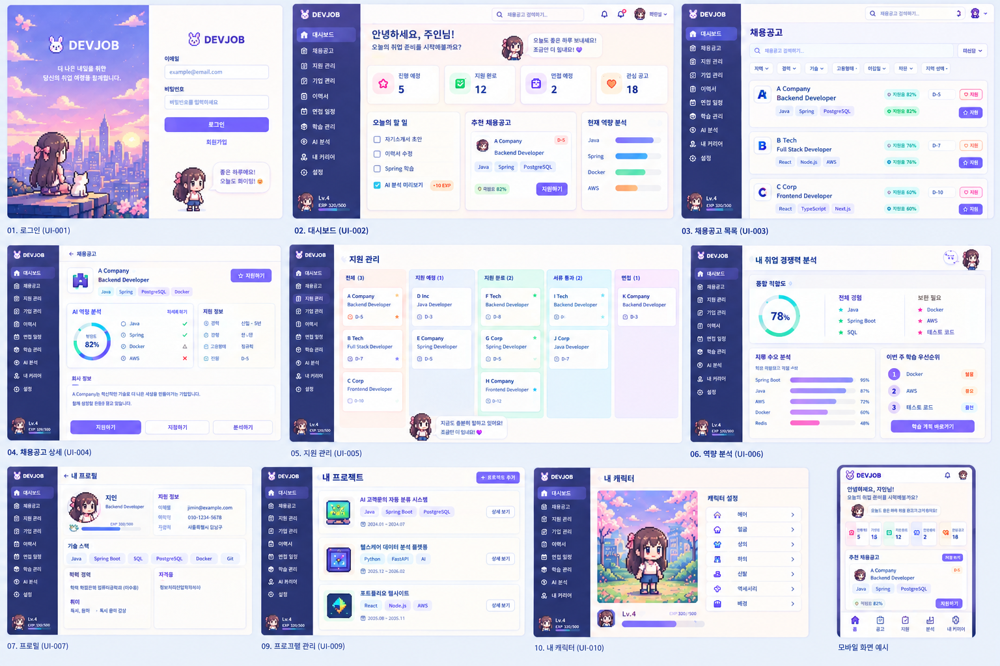

# DevJob 프론트 디자인 개편안

상태: 시각 디자인 참고안 · 기준: 2026-10-08; 기능 적용 범위는 [2026-10-09 프론트 요구사항](frontend-redesign-requirements.md)과 [실행 계획](frontend-redesign-implementation-plan.md) 참조

## 1. 목적과 적용 원칙

첨부 이미지는 **시각 디자인의 참고 자료**다. 화면에 그려진 문구·숫자·메뉴·캐릭터 성장·기능은 구현 요구사항이나 데이터 계약이 아니다. 실제 화면 구성과 행동은 현재 구현된 [API 명세](api-spec.md), [기존 UI 명세](ui-spec.md), [확장 요구사항](extension-requirements.md), [확장 UI 명세](extension-ui-spec.md), [프론트 요구사항](frontend-redesign-requirements.md)을 따른다. B00~B15 Backend 완료에 따라 이 문서의 과거 “아직 없는 기능” 표현은 당시 프론트 화면 상태를 뜻한다. 새 기능의 구현 범위와 라우트는 프론트 요구사항 P00~P20이 우선한다.

이번 문서가 정하는 것은 색·배치·타이포그래피·카드·탐색·반응형·화면별 시각적 구성이다. 인증, 데이터 저장, 필터, 상태 전이, 분석 결과의 의미는 기존 계약을 유지한다. 장식 이미지는 [이미지 제작 가이드](image-generation-brief.md)에 따라 새로 만들고 `frontend/src/assets/redesign/`에 모은다. 기존 장식 이미지 폴더는 개편안에 재사용하지 않는다. 새 캐릭터 이미지도 상태·아이템 데이터처럼 표현하지 않는다.

### 이미지에서 가져올 디자인 언어

| 요소 | 적용 방향 | 그대로 복제하지 않을 점 |
| --- | --- | --- |
| 전체 분위기 | 깨끗한 연보라·크림 바탕, 선명한 남보라 텍스트, 절제된 픽셀 장식 | 이미지의 예시 회사·수치·사용자 정보 |
| 탐색 | 짙은 남보라색 사이드바, 현재 화면의 밝은 강조, 간결한 상단 바 | 연결되지 않은 메뉴를 미리 활성화하는 것 |
| 콘텐츠 | 얇은 테두리와 약한 그림자의 흰 카드, 카드별 한 가지 역할 | 모든 정보를 작은 카드에 억지로 압축하는 구성 |
| 행동 | 보라색 주요 버튼, 연한 보조 버튼, 작은 상태 배지 | 실제 기능과 다른 `지원하기`·보상 버튼 의미 |
| 캐릭터 | 화면 머리말·빈 상태의 작은 동반자, 로그인 일러스트 분위기 | 서버 응답과 무관한 레벨·EXP·장착 상태 |
| 모바일 | 상단 정보 축소, 핵심 화면의 빠른 탐색, 세로 카드 배열 | 하단 탭만으로 모든 기능을 숨기는 구조 |

## 2. 현재 제품과 참고 이미지의 대응

아래 표는 2026-10-08 당시 화면에 참고 이미지를 적용하던 대응표다. 로그인 전 공개 홈과 B00~B15 전체 기능을 연결하는 신규·확장 화면은 [프론트 요구사항 P00~P20](frontend-redesign-requirements.md#3-페이지별-요구사항)에서 정의한다.

| 참고 이미지의 장면 | 현재 제품에서 적용할 화면 | 사용할 수 있는 실제 정보 | 화면에서 제외하거나 바꿀 표현 |
| --- | --- | --- | --- |
| 01 로그인 | `#/login`, `#/register` | 이메일·비밀번호 입력, 가입/로그인 결과 | 예시 계정·가짜 환영 메시지 |
| 02 대시보드 | `#/` | 지원 상태별 건수, 관심공고 수, 다음 행동, 추천 공고, 부족 기술 미리보기 | 임의의 목표 체크·EXP·알림 수치 |
| 03 채용공고 목록 | `#/jobs` | 저장 공고 검색·필터·정렬·출처·마감일·적합도·북마크·지원 상태 | 제공되지 않은 회사 로고, 자동 지원 버튼 |
| 04 채용공고 상세 | `#/jobs/{jobId}` | 공고 본문·원문·분석 상태·기술·역량 비교·관심 등록·지원 기록 | 실제 분석 전의 적합도 수치, 자동 외부 지원 |
| 05 지원 관리 | `#/applications`, `#/applications/{id}` | 지원 목록·상태·메모·다음 일정·상태 이력 | 이미지의 임의 보드 단계·드래그로 상태 전이 |
| 06 역량 분석 | `#/skill-gap`, 공고별 비교 | 부족 기술·표본·우선순위, 공고별 일치/부족 기술 | 표본 없이 표시한 종합 점수·학습 완료 기록 |
| 07 프로필 | `#/profile` | 프로필 필드와 보유 기술 | 저장하지 않는 전화번호·프로필 사진·숙련도 수치 |
| 09 프로젝트 | `#/projects` 및 상세·등록 | 프로젝트 내용·기간·역할·연결 기술 | 서버에 없는 프로젝트 그림·성과 수치 |
| 10 캐릭터 | `#/character` | 현재 정적 캐릭터와 기존 기능 링크 | 레벨·EXP·의상 선택·저장 기능 |
| 모바일 예시 | 현재 모든 보호 화면 | 현재 경로와 주요 행동 | 구현되지 않은 메뉴와 알림 배지 |

이미지에 없는 **관심 공고 `#/bookmarks`**, **시장 분석 `#/analytics/skills`**, **설정 `#/settings`**와 새 확장 화면도 같은 시각 체계로 개편한다. 직접 등록 공고와 수집 공고의 구분을 유지한다. 전체 화면·API 대응은 [프론트 요구사항 3~4절](frontend-redesign-requirements.md#3-페이지별-요구사항)을 따른다.

## 3. 공통 시각 체계

### 3.1 색과 표면

- 배경은 아주 연한 보라·크림 계열의 단색 또는 미세한 색 변화로 둔다. 본문 카드는 흰색에 가까운 표면, 얇은 보라빛 테두리와 약한 그림자를 사용한다.
- 주요 탐색 영역은 짙은 남보라를 사용한다. 현재 메뉴는 더 밝은 보라색 바탕과 명확한 텍스트로 표시한다. 헤더와 콘텐츠의 경계는 테두리로 구분한다.
- 주요 행동은 선명한 보라색 채움 버튼, 보조 행동은 흰색/연보라색 윤곽 버튼, 파괴적 행동은 별도 위험색으로 표현한다. 성공·경고·오류·분석 중은 텍스트와 아이콘을 함께 사용한다.
- 실제 구현에서는 `frontend/src/styles.css`의 기존 토큰을 출발점으로 색상 토큰을 한곳에서 정리한다. 현재 파일의 중복 `:root` 선언 때문에 한 부분만 바꾸고 끝났다고 판단하지 않는다. 최종 색 값은 화면 렌더링과 대비 확인 후 확정한다.
- 참고 이미지의 강한 파스텔 배경은 큰 배너·상태 배지·분석 카드의 일부에만 사용한다. 입력·긴 본문·표의 배경은 충분히 차분하게 유지한다.

### 3.2 글자와 밀도

- 기존 시스템 웹 폰트를 기본으로 유지한다. 제목은 굵기와 크기로 계층을 만들고 본문은 장식용 픽셀 글꼴로 바꾸지 않는다.
- 한 카드에는 하나의 핵심 질문이나 행동을 둔다. 보조 수치·배지는 카드 내부에서 시선의 두 번째 단계로 읽히게 한다.
- 본문·입력 라벨은 작은 참고 이미지의 글자 크기를 그대로 옮기지 않는다. Desktop과 Mobile 모두 읽을 수 있는 크기·줄간격을 유지한다.
- 카드 간 간격, 패딩, 모서리, 배지 높이는 공통 규칙으로 맞춘다. 화면마다 임의 값을 쌓지 않도록 재사용 가능한 스타일을 사용한다.

### 3.3 공통 컴포넌트

| 컴포넌트 | 개편 방향 | 필수 표시 상태 |
| --- | --- | --- |
| Sidebar·Header | 참고 이미지처럼 어두운 탐색과 밝은 작업 공간을 분리한다. 검색/알림 아이콘은 실제 기능이 없으면 행동 요소로 노출하지 않는다. | 현재 위치, 접힘/펼침, 로그인 사용자 |
| 카드 | 얇은 경계·약한 그림자·차분한 바탕, 제목과 행동의 분명한 계층 | 기본, hover/포커스, 로딩/빈/오류 |
| KPI 카드 | 큰 숫자와 짧은 설명, 필요하면 작은 아이콘·색 구분 | 0, 데이터 없음, 조회 실패 |
| 공고 카드 | 회사명·제목·출처·조건·마감·지원/관심 상태를 읽기 쉬운 순서로 | 긴 제목, 누락 필드, 마감, 분석 전 |
| 배지·칩 | 역할·기술·상태·출처를 작은 라벨로 구분 | 선택/미선택, 긴 이름, 여러 개 줄바꿈 |
| 필터 | 검색 입력과 중요한 필터를 먼저 보이고 나머지는 확장 영역으로 정리 | 적용 중, 초기화, 잘못된 값, 결과 없음 |
| 데이터 시각화 | 막대·원형 등은 실제 서버 수치와 텍스트를 함께 표시 | 값 없음, 계산 불가, 작은 표본 |
| 캐릭터·일러스트 | 새 폴더의 개편용 캐릭터·장식 이미지를 사용하며, 생성 전에는 장식 영역을 숨길 수 있다 | 이미지 실패 시에도 정보·행동 사용 가능 |
| 공통 상태 | `LoadingState`·`EmptyState`·`ErrorState`·`SuccessState`의 정보 계층을 새 카드 스타일에 맞춘다 | 로딩, 빈 값, 실패·재시도, 성공 |

## 4. 레이아웃과 반응형

- **Desktop(1024px 이상):** 고정된 시각적 기준의 왼쪽 Sidebar, 얇은 상단 Header, 넓은 콘텐츠 영역. 대시보드는 소개 영역→KPI→다음 행동/추천/역량 미리보기 순서로 배치한다. 콘텐츠 폭이 넓어져도 긴 문장이 과도하게 늘어나지 않게 한다.
- **Tablet(600~1023px):** 현재 접이식 탐색을 유지한다. 카드 그리드는 두 열 이하로 줄이고, 필터는 줄바꿈한다. 화면 제목과 주요 행동을 첫 화면에서 찾기 쉽게 한다.
- **Mobile(599px 이하):** 콘텐츠는 한 열, KPI는 화면 폭에 맞춰 2열 또는 한 열, 상세 정보는 위에서 아래로 읽게 한다. 참고 이미지의 하단 탭을 적용한다면 `대시보드·공고·지원·프로필` 같은 실제 경로만 사용하고 나머지 기능은 접근 가능한 메뉴에 남긴다. 하단 탭과 화면의 마지막 버튼이 겹치지 않도록 여백을 둔다.
- **320px 폭:** 긴 기술명·회사명·오류 메시지, 여러 배지, 표·필터가 수평 화면을 넘지 않아야 한다. 지원 보드나 통계 표처럼 폭이 필요한 요소는 의미 있는 세로 카드/목록으로 바꾼다.
- 기존 명세의 최소 44px 조작 영역, 눈에 띄는 키보드 포커스, 본문 바로가기, 모션 감소 설정을 유지한다. 색상만으로 상태를 구분하지 않는다.

## 5. 화면별 시각 개편

### 5.0 로그인 전 공개 홈

- 비로그인 사용자의 첫 `#/`에서 DevJob 브랜드, 서비스 목적, 실제 제공 기능인 공고 탐색·지원 기록·역량 관리 소개와 `로그인`·`회원가입` 행동을 보여준다. 로그인 사용자의 같은 경로는 대시보드다.
- 공개 홈은 Sidebar가 없는 별도 레이아웃으로 구성한다. Desktop에서는 짧은 소개와 개편용 일러스트를 균형 있게 놓고, Mobile에서는 제목·설명·CTA를 먼저 보여준다. 전용 장면 `CUR-15`는 [이미지 제작 가이드](image-generation-brief.md)의 컨셉에 맞춰 F02 화면 작업 때 `imagegen` 스킬로 생성·적용한다. 장식 이미지가 없어도 안내와 이동이 가능해야 한다.
- 예시 KPI·회사 로고·가짜 추천·사용자 이름을 실제 서비스 데이터처럼 표시하지 않는다. 인증 확인 중에는 공개 홈과 대시보드를 번갈아 노출하지 않으며 조회 실패는 재시도로 안내한다.

### 5.1 로그인·회원가입

- 참고 이미지처럼 Desktop에서는 일러스트/브랜드 영역과 입력 영역을 나눈다. Mobile에서는 입력 영역이 먼저 읽히고, 일러스트가 제출 버튼을 밀어내지 않게 축소하거나 아래에 배치한다.
- 라벨이 있는 이메일·비밀번호 입력, 로그인·회원가입 전환, 제출 중·오류·가입 완료 안내를 유지한다. 배경 그림의 텍스트는 장식으로 중복하지 않는다.
- 큰 배경 이미지는 별도 에셋 작업으로 제작한다. 이미지가 준비되기 전에도 레이아웃과 색상 개편을 검증할 수 있어야 하며, 기존 장식 이미지를 임시 대체재로 사용하지 않는다.

### 5.2 대시보드

- 상단에 짧은 환영 문구와 기존 캐릭터를 배치하고, 실제 집계값 4개를 카드로 보여준다. 지표는 현재 대시보드 응답의 의미를 따르며 임의의 `Lv`·EXP·알림 건수로 채우지 않는다.
- 아래에는 `다음 행동`, `추천 채용공고`, `부족 기술 미리보기`를 참고 이미지처럼 나란히 배치하고 Mobile에서는 순서대로 쌓는다.
- 지원에서 나온 다음 행동은 지원 상세로 이동하는 읽기 전용 항목이다. 별도의 개인 할 일은 B03 데이터로 표시하고 두 종류를 구분한다. 추천·역량 미리보기는 결과가 없을 때 이유를 간결히 안내한다.

### 5.3 채용공고 목록·상세

- 목록은 상단 검색/필터, 결과 건수·정렬, 공고 카드 순서다. 공고 카드의 회사 로고 자리는 실제 로고가 없으므로 회사명 첫 글자 등의 **장식적 대체 표식**을 사용한다. 실제 로고로 오해하게 만들지 않는다.
- 카드에서 제목·회사·위치·경력·고용형태·출처·기술/적합도·마감일을 서버 값이 있을 때만 표시한다. 분석 전 적합도는 `분석 전` 또는 계산 불가 안내로 처리한다.
- 상세는 공고 기본 정보→원문/본문→전형 정보(해당 출처만)→AI 분석·내 역량 비교→관심 등록·지원 기록 행동 순서로 읽히게 한다. 분석 요청은 기존 북마크 조건을 지키고, 외부 원문 열기와 DevJob 지원 기록을 다른 버튼 문구로 구분한다.
- 참고 이미지의 `D-5`는 마감일이 있을 때만 날짜를 바탕으로 계산하고, 마감된 공고·시간대 경계에 맞는 문구를 사용한다. 마감일이 없으면 숨긴다.

### 5.4 관심 공고·지원 관리

- `#/bookmarks`는 수집 공고와 직접 등록 공고를 한 목록에서 분명히 구분한다. 직접 등록 폼, 원문 보기, 분석, 지원 등록, 수정·삭제를 현재 동작 그대로 배치한다. 직접 등록 공고를 수집 공고 카드와 같은 필드가 있는 것처럼 꾸미지 않는다.
- 지원 관리는 참고 이미지의 상태별 열 구성을 디자인 방향으로 사용할 수 있다. 현재 지원 상태 8개와 허용 전이를 기준으로 표시하며, 열에 들어가지 않는 상태를 임의로 버리지 않는다. 상태 전환은 현재 상세 화면의 명시적 변경 행동을 유지한다. Drag & drop만으로 상태를 바꾸는 기능은 추가하지 않는다.
- 좁은 화면에서는 상태별 열을 세로 섹션이나 필터 가능한 목록으로 바꾼다. 상세의 메모·다음 일정·변경 이력은 카드별 구역으로 나눈다.

### 5.5 프로필·프로젝트

- 프로필은 기본 정보, 보유 기술, 선택 입력을 카드로 구분한다. 참고 이미지의 아바타는 새로 제작한 장식 캐릭터로 표현할 수 있으며, 서버에 없는 전화번호·사진·숙련도 값을 채우지 않는다.
- 프로젝트 목록은 이미지처럼 제목·역할·기간·기술을 읽기 쉬운 카드로 보여주고 `상세 보기`를 둔다. 프로젝트마다 별도 그림이 없다면 공통 픽셀 아이콘/장식을 사용한다. 등록·수정 화면은 긴 텍스트 입력과 기술 검색을 읽기 편하게 유지한다.

### 5.6 역량·시장 분석

- Skill Gap은 기술별 등장률·필수/우대 건수·표본 상태를 카드와 막대로 표현한다. 공고별 역량 비교의 `matchRate`와 전체 시장의 Skill Gap을 서로 다른 제목·설명으로 구별한다.
- 참고 이미지의 단일 종합 원형 점수는 현재 Skill Gap 응답의 의미와 맞지 않으므로 그대로 쓰지 않는다. 공고별 일치도는 해당 공고에서 계산 가능한 경우에만 원형/막대 시각화를 사용할 수 있다.
- 시장 분석은 기술별 수요와 분석 표본 수를 카드·막대로 재배치한다. B08의 경력·지역 분포 및 기간별 추이는 모수·필터·미상값을 함께 표시하고 표와 텍스트로도 읽을 수 있게 한다.

### 5.7 캐릭터·설정

- 캐릭터 화면은 참고 이미지의 큰 픽셀 배경과 설정 목록의 시각 구성을 일부 적용할 수 있다. 현재 제공하는 취업 준비 기능 링크를 유지하고 B09~B10의 실제 장착·성장·퀘스트·보상 상태를 같은 체계로 표시한다.
- 설정은 이메일·프로필/기록 바로가기·로그아웃·비밀번호 변경·알림 설정·계정 삭제를 역할별 카드로 정리한다. 위험 행동은 영향 확인과 재인증을 거친다.

## 6. Codex 구현 단위와 확인 기준

아래 D-01~D-05는 2026-10-08 시점의 **시각 디자인 분할 참고안**이다. B00~B15 전체 API 연결을 포함한 실제 구현 순서·의존성·병렬 범위는 [프론트 실행 계획](frontend-redesign-implementation-plan.md) F00~F10을 따른다. API·DB 계약 변경은 포함하지 않는다.

| 단위 | 화면·공통 요소 | 완료 확인 |
| --- | --- | --- |
| D-01 | 색상 토큰, Header·Sidebar, 카드·버튼·입력·배지·공통 상태 | 현재 기능과 탐색이 유지되고 Desktop/Tablet/Mobile에서 대비·포커스·가로 넘침을 확인 |
| D-02 | 공개 홈·로그인·대시보드 | 세션별 첫 화면, 로그인/가입 CTA, 실제 인증·집계·추천 데이터와 로딩/빈/오류 상태 확인 |
| D-03 | 공고 목록·상세·관심 공고 | 검색·필터·상세·북마크·직접 등록·분석·지원 기록 흐름 확인 |
| D-04 | 지원 관리·프로필·프로젝트 | 상태 이력·입력 보존·기술 선택·등록/수정/삭제 흐름 확인 |
| D-05 | Skill Gap·시장 분석·캐릭터·설정·모바일 탐색 | 표본/계산 불가 표시, 정적 캐릭터, 실제 메뉴 접근성 확인 |

화면별로 최소 기본·로딩·빈 결과·오류·긴 텍스트·좁은 폭을 확인한다. 1440×1000, 768×1024, 390×844, 320×812에서 주요 행동이 보이고 가로 넘침이 없는지 확인한다. 변경 후 기존 프론트 Build와 관련 화면 흐름을 실행하고, 실제 API 값과 참고 이미지의 예시 값을 혼동하지 않았는지 검토한다. 새 일러스트 제작, 하단 탭 채택, 확장 기능의 UI 추가는 해당 작업을 선택했을 때 범위를 명시한다.
